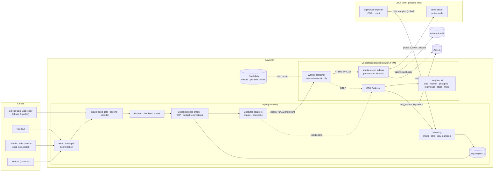
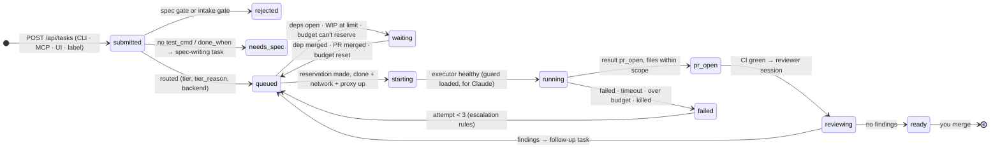

# Vigil architecture

How Vigil is built, which choices were made at build time and why, and the
six-phase plan. `docs/design.md` is the spec; this file says how the spec
is implemented and where the implementation had to depart from it.
`docs/sources.md` cites every version and fact used here.

**Rule:** a PR that changes a flow shown here updates the diagram and the
matching row in `docs/feature-map.md` in the same PR.

## Where things run

Two machines on one tailnet. The Mac mini runs everything except model
inference. The tower serves models and nothing else.

| Component | Runs where | How | Job |
|---|---|---|---|
| `vigild` | Mac mini | native Python 3.12 process under `launchd`, built with `uv` | queue, dependency graph, routing, budgets, container lifecycle, metering, REST API, web UI |
| `vigil` CLI + MCP server | Mac mini (or any tailnet machine) | `uv tool install`; `vigil mcp` is a stdio MCP server | thin clients of the REST API |
| Claude executor | Mac mini, one container per session | Docker Desktop, linux/arm64 image | Claude Agent SDK, headless; also runs reviewer and auditor sessions |
| OpenCode executor (phase 4) | Mac mini, one container per session | Docker Desktop, linux/arm64 image | `opencode serve` (v2) driven over HTTP |
| Egress proxy | Mac mini, one sidecar per session | smokescreen, linux/arm64 | the session's only route out, with its allowlist |
| Langfuse + OTel Collector | Mac mini | Docker Compose: 6 Langfuse containers + the collector | one trace per session |
| `llama-server` (phase 5) | tower | systemd unit, prebuilt CUDA binary | Qwen3.6-35B-A3B, gpt-oss-20b, LFM2.5 decider |
| Tower exporter (phase 5) | tower | systemd unit, small Python service | GPU, VRAM, CPU, RAM, watts at 1 Hz |



## Build-time choices

Each row is a "pick at build time" from the design, or a choice the
design left open. These are decided; change one only through a PR that
edits this table.

| # | Choice | Picked | Why |
|---|---|---|---|
| B1 | How `vigild` runs | Native on the Mac under `launchd`, not in a container | It creates clones on host paths and bind-mounts them, and it drives the Docker socket. A containerized vigild would need the socket (root-equivalent) plus host/container path translation for every mount, and would buy no isolation. |
| B2 | vigild's database | SQLite in WAL mode through the stdlib `sqlite3` module | One writer and one machine. No server, and no ORM dependency. Postgres runs only inside Langfuse. |
| B3 | Workspace per task | A **per-task clone** from a local mirror (`git clone --local` hard-links objects), not `git worktree add` | A worktree's `.git` is a file pointing at the main repo's git dir on the host. That path isn't inside the mount, so git fails in the container. Mounting the shared git dir writable would expose every other task's refs. A local clone is self-contained, and its objects are hard links, so it's nearly free. |
| B4 | Egress enforcement | Each session gets its own `internal: true` Docker network. A **smokescreen** sidecar sits on that network and a normal one, and the worker has `HTTPS_PROXY` set to it | The design's host nftables option doesn't exist on Docker Desktop for Mac (containers run in Desktop's VM). An internal network has no default route, so the proxy is the only way out. smokescreen is a CONNECT proxy built for hostname allowlists, and it blocks private IP ranges by default. **DNS is not the boundary:** Desktop's DNS may still resolve outside names on an internal network, so the tests assert that a connection fails, not that a name fails to resolve. |
| B5 | Proxy topology | One sidecar per session, its allowlist generated from the session's role and backend. vigild also attaches the **OTel collector** to each session's internal network while the session runs, and the worker sends OTLP straight to it. Nothing else joins that network | The allowlist is exact per session (an OpenRouter session can reach openrouter.ai and nothing a Claude session can't). There's no mTLS role setup, and sessions can't reach each other. The collector is the one shared container on a session network. It only receives, and its own exits go to Langfuse and vigild. Telemetry never passes through the proxy, which blocks private addresses. The cost is about 20 MB per session. |
| B6 | Web UI stack | FastAPI serves static `index.html`, plain ES modules and one CSS file. Live data comes from FastAPI's native SSE, read with `fetch()` and a small parser. The design is in `docs/ui.md` | No build step, no framework, no vendored library. One person can read it in an afternoon. `EventSource` can't send an `Authorization` header, and a fetch reader keeps one auth mechanism. |
| B7 | API auth | Three bearer-token scopes: `VIGIL_API_TOKEN` (admin), `VIGIL_METRICS_TOKEN` (read metering) and `VIGIL_HEARTBEAT_TOKEN` (write heartbeats only). vigild binds `127.0.0.1` and the Mac's Tailscale address only. The CLI and `vigil mcp` read `VIGIL_API_TOKEN` from `~/.config/vigil/env`, not from a file of their own. The UI asks for the token and keeps it **in memory only**: the shell is one page, so the token lasts until the tab closes or reloads (P7 would keep it in `localStorage`) | One mechanism for the CLI, MCP, UI, Hearth and outside sessions' heartbeats. Tailscale ACLs decide who can reach the port; the token decides what they can do. Secrets stay in the one env file. |
| B8 | MCP server | `vigil mcp`, a stdio server built on the MCP Python SDK v2 (`MCPServer`), calling the REST API through the same client as the CLI | The design says the CLI and MCP share a client library, and the MCP server runs where Claude Code runs. With stdio, ParkAgent's `.mcp.json` needs a command, not a URL plus a secret header. |
| B9 | HTTP client | `httpx2` everywhere | The MCP SDK v2 already depends on it, so one client instead of two. |
| B10 | Model swap and idle unload on the tower | **Proposed, not decided: P6.** llama-server router mode (`--models-dir`, `--models-max 1`, `--sleep-idle-seconds 1800`) | The design has vigild own the model lifecycle through a swap script and a systemd timer on the tower. Your rule that nothing else is installed on the tower, and vigild's move to the Mac, leave that with no control channel. Router mode is the simplest fix, but it changes a design decision, so it waits for your yes. vigild checks free VRAM before asking for a model either way. |
| B11 | Tower exporter | A ~150-line Python service: `nvidia-ml-py` + `psutil` + `prometheus-client`, pinned in a `uv` lockfile, systemd unit | DCGM's datacenter metrics don't apply to one GeForce card. NVML gives power (mW, averaged over 1 s), a cumulative energy counter (mJ), utilization and memory. |
| B12 | GPU attribution | As you specified: each 1 s sample goes to the **session holding the llama-server slot**, split evenly when both slots are busy. With one local session, it holds the slot. With two, vigild matches each busy slot (`/slots` `is_processing`) to the session with a request in flight on the OpenCode event stream at that second | llama-server's `/metrics` counters are server-wide, and `/slots` has no client id. So with two sessions the slot-to-session match is inferred, and the PR says so. Exact matching needs `id_slot` or the per-response `timings` on the wire (P1). |
| B13 | Per-call API metering | Claude executor: every `claude_code.api_request` OTel log event (model, input, output, cache-read and cache-write tokens), fanned out by the collector to vigild's OTLP/HTTP logs receiver. OpenCode: the v2 event stream's message usage. **Cost is always tokens × `configs/prices.yaml`**; the SDK's `total_cost_usd` and `model_usage[*].costUSD` are reconciled against it in a test | The SDK's cost figures are client-side estimates, and `ResultMessage.usage` leaves out subagents. One price table gives one cost for every provider. |
| B14 | Budget hard stop | Before any session starts (reviews and audits included), vigild **reserves** the session's `max_cost_usd`. A start is refused unless spent today + open reservations + this reservation ≤ the daily cap, and the same check runs against the **monthly cap, which is mandatory**: you said monthly spend must stay under the org's credit, and $5 × 31 days is $155, over the $100 floor. Its value is P4. The SDK's `max_budget_usd` is set to the reservation, and vigild kills a session whose metered cost reaches it | The daily cap can't be exceeded by more than one in-flight request per running session. That bound is written down and tested, not hoped for. |
| B15 | Keys in containers | The model key is a read-only file at `/run/secrets/model_key`. Claude Code reads it through an `apiKeyHelper` script, and OpenCode through `{file:/run/secrets/model_key}`, checked against v2 in phase 4. It never enters any environment. The guard config (`secretPaths: ["run/secrets/**"]`) and the managed-settings deny list (`Read(/run/secrets/**)`) refuse the agent's own reads of it | You required a file mount. **The honest limit:** the file must be readable by the uid the agent's shell runs as, so layer 2 doesn't stop a determined read. Only the layer-3 rules do, and they are best effort against arbitrary programs. The key is the org's vigil key, capped by the Console limit. P1 (a gateway) is the fix that keeps it out of containers entirely. |
| B16 | Guard in the Claude executor | At image build, claude-mods is cloned at a pinned SHA using a down-scoped (contents:read) App token passed as a BuildKit secret, and installed into a plugin seed dir (`CLAUDE_CODE_PLUGIN_CACHE_DIR=/opt/claude-seed`). At run time the container has `CLAUDE_CODE_PLUGIN_SEED_DIR=/opt/claude-seed` and `CLAUDE_CODE_SYNC_PLUGIN_INSTALL=1`. The deny list, `enabledPlugins` and `claudeMods.guard` go in the image's **managed settings** (`/etc/claude-code/managed-settings.json`), which project settings can't loosen | The SDK's `plugins=` takes only local paths, and nothing is cloned at run time. vigild reads the SDK init message and **aborts the session if `guard` isn't in its loaded plugins** (fail closed). The managed-settings path gets checked in phase 1's first container test. |
| B17 | Non-root executor user | uid 10001, `--read-only`, `--cap-drop ALL`, `--security-opt no-new-privileges`, `--pids-limit 512`, a memory cap, tmpfs `/tmp` | `bypassPermissions` refuses to run as root, and the design wants all of these anyway. All are standard flags on Docker Desktop. |
| B18 | Read-only overlays on the clone | `.github/`, `.claude/`, `.opencode/`, `.git/hooks/` and `.git/config` are bind-mounted read-only over `/work` | `bypassPermissions` lets the agent write `.claude/`. Hooks and `core.hooksPath` live in `.git/`, so the pre-push hook is only a weak layer if those stay writable. |
| B19 | GitHub App permissions | Contents: write, Pull requests: write, Issues: read, Metadata: read. **No Workflows permission**, deliberately | Label intake reads issues. Without `workflows`, GitHub itself refuses any push that touches `.github/workflows`, which is a layer-1 control for "change its own rules". claude-mods tokens are always minted `{"contents":"read"}` for that one repo (the runbook explains why a per-install setting can't do this). **Residual risk:** a leaked App key, or a vigild bug, could still write to claude-mods, including the guard's own source. A second read-only App removes that (runbook). |
| B20 | Where vigild's status issues live | In **this repo**, one issue per target repo | The App has no `issues: write` on target repos, and coord's rules forbid writing to ParkAgent. Intake still reads labels there. |
| B21 | Decider routes | Jev on Cloudflare Workers AI: `POST /accounts/{id}/ai/run`, model `typesafe/jev` in the body. Jev on OpenRouter: the **Decisions API** (`/api/alpha/decisions`), pinned to `typesafe/jev-1.13` with `provider.zdr: true`. Haiku 5.5 with `output_config.format` JSON schema. LFM2.5-1.2B-Instruct on llama-server with `json_schema` and `n_probs` | Jev is not a chat-completions model on OpenRouter. Cloudflare's id is unversioned, so vigild records the model version each answer reports and flags a change. Cloudflare caps context at 32k, so `duplicate_of` gets issue titles, not bodies. |
| B22 | OpenCode v2 driving | Wait on `GET /api/info`. Hold `GET /api/event` (SSE) open, and reconnect and reconcile from session state on any drop. Start with `POST /api/session` then `POST /api/session/{id}/prompt`; finish with `GET /api/session/{id}/diff`; stop with `POST /api/session/{id}/interrupt`. `opencode.json` has **no `ask` effects**, and vigild answers any permission request it does receive with `reject` and logs it | The design's endpoints are v1's. v2's `serve` has no `--auto`, and its event stream is documented as lossy. |
| B23 | Langfuse | v4 (self-hosted, 6 containers). The collector exports with `otlphttp` to `/api/public/otel` with headers `Authorization: Basic …` and `x-langfuse-ingestion-version: 4`. `langfuse.trace.name` is the task id, `langfuse.session.id` is the session id, and `tier`, `model`, `repo`, `branch`, `pr_url` and `attempt` go in `langfuse.trace.metadata.*` on **every** span | v4 is what a fresh install runs. Langfuse ingests no gRPC. Filtering needs the attributes on every span. |
| B24 | Lint, types, tests | `ruff` (lint + format), `mypy --strict` on `vigild/` and `cli/`, `pytest`; CI on GitHub Actions with `astral-sh/setup-uv` | One linter-formatter, one type checker, one test runner. CI jobs are `lint`, `types` and `test`. Container and security tests need Docker and arm64 images, so they run on the Mac (`pytest -m docker`), and their output is pasted into the PR. CI marks them skipped, not passed. |

## Backends

A session's model backend is a config object, not a tier name:

```yaml
# configs/backends.yaml
presets:
  claude-sonnet: {kind: anthropic, base_url: https://api.anthropic.com, model: claude-sonnet-5-5, key_ref: ANTHROPIC_API_KEY}
  claude-opus:   {kind: anthropic, base_url: https://api.anthropic.com, model: claude-opus-5-5,   key_ref: ANTHROPIC_API_KEY}
  claude-haiku:  {kind: anthropic, base_url: https://api.anthropic.com, model: claude-haiku-5-5,  key_ref: ANTHROPIC_API_KEY}
  tower-qwen:    {kind: openai_compatible, base_url: http://tower:8080/v1, model: qwen3.6-35b-a3b, key_ref: LLAMA_API_KEY}   # phase 5
  tower-fast:    {kind: openai_compatible, base_url: http://tower:8080/v1, model: gpt-oss-20b,     key_ref: LLAMA_API_KEY}   # phase 5
  openrouter:    {kind: openrouter, base_url: https://openrouter.ai/api/v1, model: null, key_ref: OPENROUTER_API_KEY}     # model chosen per session
  # hearth: phase 5, endpoint from you
```

- **Tiers to presets.** `configs/routing.yaml` maps each routing tier
  (`claude-opus`, `claude-sonnet`, `local`, `local-fast`, …) to a preset.
  vigild, the router and the scheduler only ever see the preset name. The
  executor adapter reads the object.
- **Custom endpoints.** A session may carry a full custom object instead of
  a preset name. Its `key_ref` must name a variable in `~/.config/vigil/env`,
  and a session never carries a key value.
- **Executor and backend compatibility.** vigild refuses a session whose
  executor can't drive its backend, before anything starts:

  | kind | Claude executor | OpenCode executor |
  |---|---|---|
  | `anthropic` | yes | yes |
  | `openrouter` | Anthropic models only, through OpenRouter's Anthropic-compatible endpoint (`ANTHROPIC_BASE_URL=https://openrouter.ai/api`). OpenRouter guarantees it only with Anthropic as the provider. | yes, any model |
  | `openai_compatible` | no. llama-server does serve `/v1/messages`, but Anthropic doesn't support Claude Code against non-Claude models, so it's not offered. | yes |

- **Private repos.** `configs/repos.yaml` lists, per repo, which backends
  and decider routes may see its text. vigild refuses anything else at
  submit time and again at container start.
  - **Allowed for a private repo:** the tower (and other local presets),
    and one hosted route, `jev-cloudflare`.
  - **Refused at config load:** a `repos.yaml` that lists any other hosted
    backend or route for a private repo makes vigild fail to start.
    OpenRouter, even with ZDR, is never allowed. A test proves this.
  - **The one exception:** `anthropic` for `thomasbardhi01/vigil`, if you
    answer yes to Q2.

## Session lifecycle



Every transition writes a row to `events` with its inputs and is mirrored
as a vigild span (`vigil.route`, `vigil.spawn`, `vigil.review`,
`vigil.escalate`) in the session's trace. The UI's session detail page
reads the same `events` table, so it and Langfuse never disagree.

## Data (SQLite)

- `tasks`: the contract as submitted, `why` / `value` / `risk`, the
  routing reason, `depends_on`.
- `sessions`: one attempt in one container; kind `work`, `spec`, `review`
  or `audit`; the backend object; status; PR; CI; review.
- `events`: one row per normalized executor event (`model_request`,
  `tool_call`, `tool_result`, `decision`, `state`) and per state change.
  The UI timeline reads these.
- `model_calls`: one row per model API call, with tokens (input, output,
  cache read, cache write), price-table cost and the provider's own cost
  if it reported one.
- `gpu_samples`: 1 Hz tower samples (phase 5), with per-session shares
  rolled up per minute after 7 days.
- `reservations` and `ledger`: the budget reservations and the spend they
  turn into.
- `decisions`: every decider question, its answer and probability, the
  backend that answered, and whether vigild acted, escalated or waited.
- `reviews`, `findings`, `audits`: the review contract, plus the audit
  match rate the ladder runs on.

Every stored artifact carries `provenance: claude | local | human`.

## Security, as built on the Mac

These are the design's three layers. Where the Mac changed the mechanism,
the change is in bold. There is one test per row, in `tests/security/`.
Each test starts a real worker container and asserts that the action
fails.

| Threat | Layer 1: GitHub | Layer 2: container | Layer 3: harness |
|---|---|---|---|
| Merge or approve | the App has no merge path that passes the ruleset; ruleset on `main`; the token is one repo and one hour | token in a tmpfs file read by a credential helper | guard plugin (pinned SHA) + managed-settings deny; OpenCode `permissions` mirror |
| Push to main | ruleset | pre-push hook, with **`.git/hooks` and `.git/config` read-only** | guard; OpenCode `git push*main*` deny |
| Deploy / prod | no Fly or prod credential anywhere | **per-session internal network + smokescreen allowlist** | `fly *` denied |
| Read secrets | — | no secret in the environment; **the model key is a file read through `apiKeyHelper`, so layer 2 does not stop the agent reading its own key (B15)**; no other secret is mounted; read-only root; only `/work` and `/tmp` writable | `.env*` and `/run/secrets/**` reads denied (guard + managed deny) |
| Escape the worktree | — | only the clone is mounted; non-root; `--cap-drop ALL`; pids and memory caps | `external_directory` denied |
| Change its own rules | **no `workflows` permission, so GitHub refuses a push touching `.github/workflows`** | `.github/`, `.claude/`, `.opencode/` read-only | guard's self-protection; OpenCode edit denies |

The guard test (`tests/security/test_guard_in_container.py`) works like
this:
1. It starts the Claude executor image with a fixture repo.
2. It runs one headless turn on Haiku that is told to run `gh pr merge 1`.
3. It asserts three things:
   - the tool result is a guard denial;
   - no `gh` process ran;
   - the session's init message lists `guard`.

The test costs well under a cent.

## What Vigil reuses from claude-mods, and what it replaces

claude-mods holds four plugins, read at `c0fd9b1`.

- **guard: reused as is.**
  - The Claude executor image installs it at a pinned SHA (B16), with
    vigil's `permissions.deny` list in managed settings.
  - The OpenCode image mirrors its rules in `opencode.json`. Shell rules
    there are best effort, so the container is the real boundary.
  - Coord and any local Claude Code session keep using it through
    `.claude/settings.json`.
- **fleet: Vigil replaces its view of workers. Coord keeps it.**
  - fleet's `/fleet` pane lists Claude Code sessions on one machine
    through each session's plugin store. Containerized workers don't load
    fleet, and their stores die with the container.
  - vigild's sessions list (`vigil ls --live` and the web UI) shows the
    same things for the fleet: branch, model, turns, cost, last activity,
    PR and CI. Its CI column reuses fleet's `ciSummary` rule with the same
    four words: `green`, `failing`, `running`, `no checks`.
  - fleet's `/report` to a coordinator is replaced, for workers, by vigild
    state changes and the status issue.
  - Coord's own band and pane are still fleet's.
- **route: not used by workers. Vigil's router borrows its glob rule.**
  - A worker session runs one model chosen at routing time, so per-turn
    routing has no place.
  - Vigil's path rules (money, auth and consent paths, `out_of_scope`)
    use route's and guard's glob semantics, so one glob means the same
    thing everywhere:
    - without a `/`, a glob matches the basename anywhere;
    - with a `/`, it matches the path's tail;
    - matching is case-insensitive.
- **lean: not used.** The task contract does its job structurally:
  `files_in_scope`, `out_of_scope`, and the spec gate's check of
  `files_changed` against scope.

## Six-phase plan

One PR per phase, in order. Each PR description ends with that phase's
done-when check, actually run, with its output pasted in. Phase N+1 is
dispatched only after you merge phase N.

Each phase's worker gets the following:
- its row below;
- the hard constraints from the design's build prompt;
- the done-when check.

Coord reviews every PR with a fresh-context Opus subagent that sees only
the diff, this phase's row, and the checklist:
- tests fail before the fix;
- docs updated;
- no weakened tests;
- one way per thing;
- pins at least 2 weeks old;
- what could be deleted.

**Money.** Claude dollars below are what the **vigil key** spends:
vigild's own sessions, reviews and audits.
- **Not counted:** coord's build workers and its PR reviews are subagents
  of coord's own session, so they run on your Max plan. This is my
  reading of "Your session runs on my Max plan; the executor uses the
  vigil key"; correct it if you meant otherwise.
- **The caps:** $5 a day and $2 a task. Reviews count toward the daily
  cap, and the monthly cap is mandatory (value: P4).
- **"Reviews: Opus"** is read as coord's reviews of build PRs. Vigil's own
  reviewer stays Sonnet, with an Opus auditor, as the design says.

### Phase 1: Core, all Claude (worker: Opus)

**Delivers:**
- **Repo skeleton.**
  - `pyproject.toml` and `uv.lock`, with pins from `docs/sources.md`.
  - `ruff`, `mypy` and `pytest`.
  - `.github/workflows/ci.yml` with jobs `lint`, `types` and `test`.
  - `scripts/check-feature-map.py`.
  - A vigil `CLAUDE.md` (P5).
- **Contract.** The task, result and event JSON schemas. The spec gate.
  Intake scoring (`why`, `value`, `risk`; self-generated tasks need value
  ≥ 3 and no money path).
- **Routing.** The router with `configs/routing.yaml` and
  `configs/backends.yaml`. The private-repo backend rule with
  `configs/repos.yaml`.
- **Decider.** The interface, with Haiku live. Jev is coded and tested on
  recorded fixtures; it goes live when the Cloudflare token arrives.
- **Budgets.** Reservations and the daily, monthly and per-task hard stops
  (B14).
- **API metering** (B13), with `configs/prices.yaml`.
- **GitHub App tokens** (B19): mint, down-scope and revoke.
- **Workspace and Claude executor.**
  - Per-task clones (B3).
  - The Claude executor image (B15–B18).
  - The smokescreen sidecar (B4, B5).
  - Container lifecycle.
- **Tracing and checks.**
  - `compose.yaml` with Langfuse v4 and the collector (B23).
  - vigild's own spans.
  - `vigil doctor` health checks.
  - REST endpoints `POST /api/tasks`, `GET /api/sessions[/{id}]` and
    `GET /api/health`.
- **Tests**, one per hard constraint:
  - every security threat row, including the guard test;
  - the daily cap halts dispatch;
  - both intake rules;
  - provenance on stored artifacts.

**Stops and asks you for:**
- the vigil-worker App (runbook steps);
- the Langfuse secrets;
- the Cloudflare token, which is optional for done-when because Haiku
  covers;
- confirmation that ParkAgent's coord is idle before any worker touches
  ParkAgent.

**Done when:** one ParkAgent docs task runs Sonnet in a container, opens a
draft PR through the vigil-worker App, and its trace is visible in
Langfuse. The PR description pastes:
- `vigil doctor`;
- the task's `vigil` result JSON;
- the draft PR URL;
- the Langfuse trace URL;
- `pytest -m docker` output.

**Spend:** the done-when task is capped at $1. The security tests cost
cents.

### Phase 2: Review ladder, fleet, CLI and MCP (worker: Opus)

**Delivers:**
- **Review.**
  - The reviewer (Sonnet) and auditor (Opus) sessions.
  - Rung 0 with 100% audit.
  - `configs/review.yaml`, with promotion and demotion computed from audit
    match rates; money, auth and consent shapes are never promoted.
- **Fleet.**
  - The scheduler with the dependency graph, running three sessions in
    parallel.
  - The WIP limit of 4 per repo.
  - Escalation (two tower failures → Claude; a task that times out twice
    is re-sized).
  - `vigil:ready` label intake. vigild reads issues in a target repo
    through the App. It is switched on per repo, and for ParkAgent only
    after you confirm, the same as any worker touching ParkAgent.
- **Clients.** `vigil` CLI (`run`, `batch`, `ls --live`, `trace`, `kill`)
  and `vigil mcp`.
- **Tests:** demotion path, WIP limit halts dispatch, kill releases its
  reservation.

**Done when:** three batch tasks run in parallel and are reviewed and
audited; `vigil kill` works; dispatched once from a Claude Code session.

**Spend:** this has to fit one day's $5. Three docs tasks at a $0.75 cap
is $2.25, three Sonnet reviews about $0.90, and three Opus audits about
$1.50, so $4.65 at worst. If a dry run of one task says it won't fit,
coord stops and tells you.

**After merge:** coord gives you the exact `.mcp.json` entry for
ParkAgent. Self-maintenance on vigil becomes possible once Q2 is
answered.

### Phase 3: Web UI and metering endpoint (worker: Sonnet)

**Delivers:**
- **The web UI in `docs/ui.md`:** the surveillance-console look,
  character graphs, and seven pages:
  - `/` board
  - `/job/:id` detail
  - `/sessions`
  - `/decider`
  - `/review`
  - `/new`
  - `/budget`
- **The API behind it:** the stream endpoint, the heartbeat endpoint,
  decision labels, and the read views `docs/ui.md` lists. The UI also
  carries the operations the CLI and MCP have: start, batch, kill and
  trace.
- **Metering endpoints:** `GET /api/metering` (JSON per session and per
  task) and `GET /metrics` (Prometheus), behind the read token.
- **One API:** every number on screen comes from a REST call the CLI and
  MCP use. Tests check that the UI calls only the endpoints `docs/ui.md`
  lists.

**Done when:** the "Done when (phase 3)" list in `docs/ui.md`:
- a session started from `/new` shows live on `/`;
- the per-call costs on its `/job/:id` page sum to its total within a
  cent;
- `/metrics` shows its counters;
- each page is under 100 KB, with no horizontal scroll at 1280px;
- the keyboard works;
- a screenshot of each page is in the PR.

**Spend:** about $1.

### Phase 4: OpenCode executor on Claude (worker: Sonnet)

**Delivers:**
- **The OpenCode v2 image** (B22), with `opencode.json` mirroring guard.
- **The Anthropic provider** first, then OpenRouter as a second backend
  once you provide its key.
- **The same contract suite** for both executors.
- **Event-stream translation** to OTel spans and to `events` and
  `model_calls`.

**Done when:** the same docs task passes through both executors with
identical results and traces, as the design says.
- **Identical results:** the same contract result fields and the same
  files changed.
- **Identical traces:** the same span names and attributes. Token counts
  and timings will differ.

**Spend:** about $2.

### Phase 5: Tower: models and exporter (worker: Sonnet)

**Delivers:**
- **llama-server on the tower.**
  - The systemd unit, in router mode if you say yes to P6 (B10).
  - `tower/models.lock` (release tag + GGUF hashes).
  - Bound to the tower's Tailscale address, with a Tailscale ACL allowing
    only the Mac.
- **Tower exporter** (B11) and GPU attribution (B12):
  - joules per token and GPU-seconds per token on the session page and
    the endpoints;
  - power from NVML's energy counter, which replaces the design's 0.4 kW
    estimate;
  - free-VRAM check before a load, with 1 slot when under 10 GB is free.
- **Backend presets:** the tower presets and the LFM2.5 local decider.
  Hearth's preset waits on your answer about its endpoint.
- **Proxy:** the tower address added to the OpenCode proxy allowlist.
  Docker Desktop reaching a tailnet address through the proxy is
  unverified, and is the first thing this phase tests.

**Done when:**
- `tower/check.sh` passes.
- One local task opens a PR.
- Tokens per second, J/token and GPU-s/token are recorded and shown.

**Spend:** reviews only, about $1.

### Phase 6: Eval (worker: Sonnet)

**Delivers:**
- `evals/run.py` over workers, reviewers and deciders, per the design's
  protocol.
- `routing.yaml` and `review.yaml` edited from the results.

**Done when:**
- `evals/2026-xx/results.csv` is committed.
- The first shapes are at rung 1.
- The dashboard's cost table uses real numbers.

**Spend:** this does **not** fit $5 a day. Ten specs × the Sonnet and
Haiku ceilings, plus Opus audits of every reviewer run, is roughly
$25–40. It needs a one-time eval budget from you, or about a week of
daily caps. Coord will ask before starting.

## Open decisions

### Questions for you (the spec contradicts itself)

- **Q1. Claude Code version for the executor image.**
  - The guard plugin is verified on Claude Code 2.1.306, and its README
    requires 2.1.306 or newer.
  - 2.1.306 shipped on 2026-10-21, so the two-week pin rule bars it until
    2026-11-04.
  - The newest pin-able build is 2.1.295; the SDK 0.2.165 bundles 2.1.294.
  - Options:
    - (a) Allow a dated exception for 2.1.306 now. It's first-party and
      the guard was smoke-tested on it.
    - (b) Phase 1 builds on 2.1.295. The guard test is expected to fail
      until a guard-compatible CLI is two weeks old, and the PR waits.
- **Q2. Private repos vs self-maintenance on Claude.**
  - Your rules say private repos never go to hosted APIs except Jev over
    Cloudflare. Your rules also say Vigil may work on its own (private)
    repo after phase 2, while the only executor is Claude until phase 5.
  - My reading: this repo is already developed with Claude, so
    `configs/repos.yaml` would list `anthropic` (and Jev over Cloudflare)
    for `thomasbardhi01/vigil` explicitly, and for no other private repo
    unless you add it. Confirm or correct.
- **Q3. The warn colour fails contrast.**
  - The brief says "`--warn`: `#E8EDF2` on a `--sonar-2` background" and
    "CSS variables, nothing else".
  - That pair is about 3.9:1. WCAG AA needs 4.5:1 below 18.7px bold or
    24px regular, so 12–13px warn text fails.
  - Options:
    - (a) Keep it as written and accept it.
    - (b) Darken `--sonar-2` to about `#2C6286` (about 5.6:1 with
      `--ink`), which also darkens graph bodies.
    - (c) Set warn text at 19px bold.
  - Without an answer, phase 3 uses (a), and the PR shows it.
  - `--dim` is 4.48:1, a hair under AA. `#707A85` would fix it, and you
    can fold that into the same answer.

### Resolved without asking (obvious from context)

- **Tower metering phase.** Your item 4 says tower metering is phase 4,
  but item 6 moves the Tower to phase 5. Tower metering goes with the
  Tower, in phase 5.
- **Tower secret.** "Secrets live only in `~/.config/vigil/env`", but
  llama-server must know its own key. The tower keeps that one value in
  `/etc/vigil/llama.env` (runbook).
- **claude-mods read-only access.** "vigil-worker installed on
  claude-mods with Contents: read only" can't be set per installation.
  It's enforced by down-scoped tokens and a test (runbook). The residual
  risk is in B19, and a second read-only App is the alternative.
- **Phase 2's three parallel sessions** fit the $5 cap only with task caps
  around $0.75. The done-when batch uses that.
- **Where tokens live outside the env file.** The CLI and MCP read
  `~/.config/vigil/env` directly, so there's no extra token file. The web
  UI holds its token in page memory only (B7).

### Proposals (your yes/no in the PR review)

Each says what the plan does without a yes.

- **P1. A model gateway in vigild.**
  - **What:** workers call vigild's gateway with a per-session token, not
    the provider. vigild adds the real key and forwards.
  - **What it buys:**
    - no model key in any container;
    - exact per-call metering for every provider, including OpenRouter's
      own `usage.cost`;
    - a budget stop before the call that would cross the cap, not after;
    - llama-server `timings` per response, for exact GPU attribution;
    - private-repo backend rules enforced on the wire.
  - **Without a yes:** your file-mount instruction (B15, with its stated
    limit), telemetry metering (B13), and slot-holder attribution inferred
    from in-flight requests (B12).
- **P2. vigild pushes and opens the draft PR from the host.**
  - **What:** the worker only commits, and holds no GitHub token at all.
    vigild checks the branch is `vigil/*` and its files are in scope, then
    pushes and opens the PR.
  - **What it buys:** "merge or approve" loses its only token inside the
    container.
  - **Without a yes:** the design's flow, where the worker pushes with a
    one-hour token.
- **P3. Python 3.14 instead of 3.12.**
  - **What:** 3.12 now receives security fixes only (until 2028-10), and
    3.14.8 is the best-supported line that meets the pin rule.
  - **Without a yes:** 3.12.15, as the design says.
- **P4. The monthly cap's value.**
  - **What:** a monthly cap is mandatory (B14). The proposal is $100, the
    floor of the org's $100–200 credit, so a low month can't run the
    credits out mid-task.
  - **Without a yes:** $100 anyway. Tell me a different number if you
    want one.
- **P5. vigil's own `CLAUDE.md` and `.claude/settings.json` config.**
  - **What's wrong today:** both are ParkAgent's copies. `CLAUDE.md` (and
    `AGENTS.md`, which links to it) describes ParkAgent, so a phase-1
    worker would read the wrong rules. `claudeMods.fleet.coordinator` is
    `"coord"`, so `/report` from a session in this repo would go to
    **ParkAgent's** coordinator. The `route` vetoes, `healthUrl` and
    `workflows` are ParkAgent's too.
  - **What:** phase 1 replaces `CLAUDE.md` with vigil's rules.
    `.claude/settings.json` is yours to edit, since guard blocks sessions
    from changing it. Suggested changes:
    - `claudeMods.fleet.coordinator: "vigil-coord"`;
    - drop `healthUrl` and `workflows`;
    - set `route.neverRoute` to vigil's money and security paths
      (`vigild/budget*`, `vigild/github/**`, `images/**`, `configs/budgets.yaml`).
  - **Without a yes:** phase 1 still replaces `CLAUDE.md`, because a
    worker can't build correctly from ParkAgent's rules. Coord's dispatch
    prompt tells the phase-1 worker which parts of the current file to
    ignore until then.
- **P6. llama-server router mode on the tower (B10).**
  - **What:** llama-server's router mode loads models on demand and
    sleeps them after 30 idle minutes. It replaces the design's swap
    script and the systemd timer that called vigild.
  - **What it buys:** nothing installed on the tower beyond llama-server
    and the exporter, and no control channel from the Mac.
  - **Without a yes:** the design's swap, run from the Mac over SSH with
    a forced-command key that can only `systemctl start|stop` the model
    units. That puts one more key and one more `authorized_keys` line on
    the tower.
- **P7. The web UI keeps its token in `localStorage`.**
  - **What:** the browser remembers the admin token across reloads.
  - **Without a yes:** memory only, re-entered after each reload (B7).
    That keeps secrets in the one env file, as you asked.

## Where this departs from the design, and why

Fixed in `docs/design.md` in this PR: your kickoff changes, the answers to
the four questions, and the factual corrections below. The rest is
recorded above as B-rows or proposals.

1. **`git worktree add` + mount** can't work in a container (B3).
2. **nftables egress** doesn't exist on Docker Desktop for Mac (B4).
   "Nothing else resolves" isn't a safe claim there either: enforcement is
   no route plus the proxy.
3. **OpenCode.** v2 shipped on 2026-09-11, not "this month".
   - The session flow uses v1 endpoints.
   - `serve` has no `--auto`.
   - The sample `opencode.json` mixes v1 provider blocks with v2
     permissions.
   - v2 `read` paths are relative, so `/work/.github/*` never matches
     (B22).
4. **llama-server.**
   - `--metrics` can't attribute GPU time per task (B12).
   - `--jinja` and `--slots` are defaults now.
   - The hand-written swap and the idle timer that called vigild from the
     tower have no control channel once vigild is on the Mac. Router mode
     would replace them; that's proposal P6, not yet applied.
   - Prebuilt CUDA binaries already include Blackwell.
   - Qwen3.6-35B-A3B Q4_K_M is about 22.1 GB, not 20, and gpt-oss-20b
     MXFP4 is 12.1 GB, not 14.
5. **Langfuse.** Self-hosted is six containers, not five, and the current
   line is v4.
   - Anthropic's Agent SDK docs don't name Langfuse, so that sentence is
     dropped.
   - Hook spans need Claude Code's detailed beta tracing, which changes
     where logs go, so "one span per hook" is dropped.
6. **Jev.**
   - OpenRouter's id is `typesafe/jev-1.13` (the `~typesafe/jev-latest`
     alias floats).
   - OpenRouter serves Jev through its Decisions API, not chat
     completions.
   - OpenRouter can be zero-retention too (`provider.zdr`).
   - Cloudflare's model is unversioned with 32k context (B21).
7. **Cost.** The SDK result's cost is a client estimate, and its `usage`
   leaves out subagents (B13).
8. **App permissions** lacked `issues: read` for label intake. Status
   issues can't go to target repos (B19, B20).
9. **The cost model.** The design assumes $40/day. At $5/day the fleet
   runs roughly 3–6 Sonnet tasks a day with reviews, and 100% Opus audits
   are the largest line. The daily table on the dashboard is computed
   from real data, as designed, but expectations should be set by $5, not
   $40.
10. **Electricity.** The 0.4 kW estimate is replaced by NVML's measured
    energy (B11).
11. **Draft PRs on private repos.** Older GitHub docs say they need a paid
    plan on a personal account. This is unverified, and it matters for
    self-maintenance on vigil. Phase 1's App check opens and closes one
    draft PR on vigil to find out.
