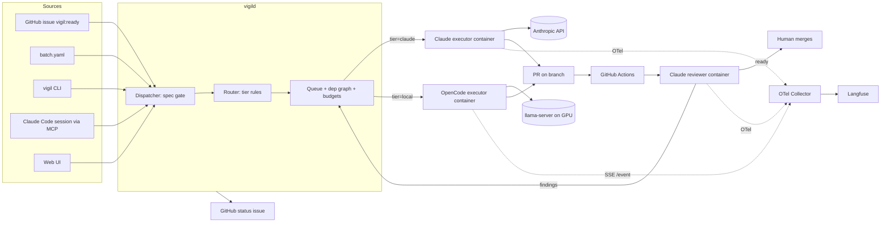

# Vigil: design doc

Oct 22, 2026 · @Thomas Bardhi

> **Revised 2026-10-22 (PR 1, vigil-coord).** This revision applies your kickoff's changes:
> - Everything but model serving runs on the Mac mini.
> - Model backends are config objects.
> - A web UI and a metering endpoint are new phase 3.
> - Metering covers API tokens and tower power.
> - Vigil may work on its own repo after phase 2.
> - Six phases.
> - The answers to the four open questions.
>
> It also corrects the facts the research disproved. How each part is built, the choices picked at build time, the full phase plan and the open decisions are in `docs/architecture.md`; versions and citations are in `docs/sources.md`.

## Summary

Vigil is one orchestrator that runs many isolated coding sessions in parallel across your repos, routes each task to a model backend (Claude, a local model on your Linux tower, OpenRouter, or a custom endpoint), and records every session as one trace you can open. Claude does first drafts, anything hard or on a money/auth path, and every review. OpenCode workers on the tower do routine work for free.

The operating rule: **a task is a contract, not a chat.** Every session gets a written spec with a test that must go from red to green, runs in its own container and worktree, cannot merge or deploy, and ends in a PR that a fresh-context Claude reviews before a human merges. Spawn from the CLI (`vigil run`), from a Claude Code session (an MCP tool), from the web UI, or from a GitHub label; all four hit the same API.

Stack, pinned at build time (`docs/sources.md`):
- **Orchestrator:** Python 3.12 (FastAPI + SQLite + a dependency-graph scheduler), running natively on the Mac mini.
- **Workers:** linux/arm64 worker containers under Docker Desktop. Each runs the Claude Agent SDK or an OpenCode v2 server.
- **Models:** llama.cpp `llama-server` on the tower, the only thing the tower runs besides a small metrics exporter.
- **Tracing:** OpenTelemetry into self-hosted Langfuse v4.
- **Networking:** Tailscale.

## What an expert would insist on

These eight choices are where fleets fail or pay off. Each is a design constraint below, not advice.

1. **Local models fail on vague tasks, not on hard ones.** A 35B MoE can write a test from a spec; it cannot discover what the spec should be. So Claude writes specs, and the cheap tier only ever receives a task with a named test, named files and a definition of done. Routing is by *task shape*, not by how smart the model is.
2. **Isolation is physical, not configured.** OpenCode's permission JSON is friction, not a boundary; a model can `cat` what it was told not to `read`. The boundary is the container: read-only root, one worktree mounted, an egress allowlist, no secrets in the environment. Permissions only reduce wasted turns.
3. **The agent cannot grade itself.** Every PR gets a fresh-context Claude review that sees only the diff and the issue. Tests run in CI, not in the worker's shell, so a worker cannot weaken a test and call it green.
4. **One task contract for every executor.** Claude and OpenCode workers accept and return the same JSON. Swapping models or harnesses later costs nothing above a new executor plugin.
5. **Routing decisions are logged, and the eval tunes them.** Every `tier` choice carries a reason. Ten replayed issues per quarter decide which task shapes the tower keeps and which go back to Claude.
6. **Budgets are hard stops.** Daily Claude dollar cap and per-task token caps are enforced by the orchestrator, not by hope. Escalation from the tower to Claude happens after two failures, never silently.
7. **Traces are the product.** If you can't open a session and see every tool call, token and cost, you can't trust it unattended. Both tiers feed one trace store with one schema.
8. **Claude outputs never enter a training set.** A provenance tag on every artifact and a test that asserts the training pipeline rejects them.

## Architecture

Everything runs on the **Mac mini** (Apple Silicon, Docker Desktop, images built for linux/arm64) except model inference. The **Linux tower** (RTX 5070 Ti 16 GB, 32 GB DDR5) serves models only: `llama-server` plus a small metrics exporter, nothing else. The two reach each other over Tailscale.

| Component | Runs where | Job |
| --- | --- | --- |
| `vigild` (orchestrator) | Mac mini, native under launchd | Task queue, dependency graph, routing, backends, budgets, metering, container lifecycle, status issue, REST API, web UI |
| `vigil` CLI + MCP server | Mac mini (or any tailnet machine) | `vigil run`, `vigil ls`, `vigil trace`, `vigil kill`; the same calls exposed as MCP tools so a Claude Code session can dispatch |
| Web UI | served by `vigild`, Tailscale only | New session, sessions list, session detail timeline, budgets and WIP limits; same API as the CLI and MCP |
| Claude executor | Mac mini, one container per task | Claude Agent SDK, headless, model key as a file, guard plugin, OTel on |
| OpenCode executor | Mac mini, one container per task | `opencode serve` (v2) + the task's clone, pointed at the session's backend |
| `llama-server` | tower host (GPU) | Qwen3.6-35B-A3B main, gpt-oss-20b for small jobs, LFM2.5 decider; router mode |
| Tower exporter | tower host | GPU, VRAM, CPU, RAM and watts sampled each second |
| Reviewer | Mac mini, container per PR | Claude, fresh context, diff + issue + checklist only |
| Langfuse + OTel Collector | Mac mini, Docker Compose | One trace per session |

**Model backends.** A session's backend is a config object, not a tier name:
`{kind: anthropic | openai_compatible | openrouter, base_url, model, key_ref}`.
- **`key_ref`** names a variable in `~/.config/vigil/env`, never a value.
- **Built-in presets:**
  - Claude API (Sonnet, Opus, Haiku)
  - tower llama-server
  - OpenRouter (any model id)
  - a custom endpoint
  - Hearth's local models, as a preset pointing at the tower or whatever endpoint Hearth exposes
- **Routing tiers** map to presets in `configs/routing.yaml`. vigild, the router and the scheduler see only the preset name. Executor adapters read the object.



The loop: a task enters, the spec gate rejects it unless it has a test and a done condition, the router assigns a tier with a reason, the queue starts a container when a slot and budget allow, the worker pushes a branch and opens a draft PR, CI runs, the reviewer posts findings or marks the PR ready, and findings re-enter the queue as a follow-up task (same tier, or escalated).

## Task contract

Every executor takes this in and hands this back. Nothing else crosses the boundary, so a new model or harness is one adapter.

```json
{
  "task_id": "pa-0142",
  "repo": "thomasbardhi01/parkagent",
  "base": "main",
  "branch": "vigil/pa-0142-rate-limit-tests",
  "tier": "local",
  "tier_reason": "label:tests + paths:tests/** + size:S",
  "backend": { "kind": "openai_compatible", "base_url": "http://tower:8080/v1", "model": "qwen3.6-35b-a3b", "key_ref": "LLAMA_API_KEY" },
  "why": "rate limiting has no tests; #139 changed it",
  "value": 4,
  "risk": 2,
  "spec": {
    "goal": "Add tests for rate limiting on /api/park",
    "test_cmd": "pytest tests/api/test_rate_limit.py -q",
    "must_fail_first": true,
    "files_in_scope": ["tests/api/test_rate_limit.py", "docs/feature-map.md"],
    "done_when": "test_cmd exits 0; docs/feature-map.md lists the limit",
    "out_of_scope": ["src/billing/**", "src/auth/**"]
  },
  "limits": { "max_turns": 60, "max_minutes": 40, "max_cost_usd": 4.00 },
  "depends_on": ["pa-0139"],
  "attempt": 1
}
```

Result:

```json
{
  "task_id": "pa-0142",
  "status": "pr_open | failed | escalate | timeout",
  "branch": "vigil/pa-0142-rate-limit-tests",
  "pr_url": "https://github.com/.../pull/312",
  "test_before": "fail", "test_after": "pass",
  "files_changed": ["tests/api/test_rate_limit.py", "docs/feature-map.md"],
  "summary": "3 tests; 429 after 10 req/min; docs updated",
  "usage": { "model": "qwen3.6-35b-a3b-q4", "tokens_in": 48210, "tokens_out": 6120, "tokens_cache_read": 31000, "tokens_cache_write": 0, "cost_usd": 0, "gpu_seconds": 1130, "energy_j": 312000 },
  "trace_id": "lf-9c1d...",
  "provenance": "local"
}
```

Alongside the result, every executor streams normalized events (`model_request`, `tool_call`, `tool_result`, `decision`, `state`) in one schema. The web UI's session timeline and the per-call metering read them.

The spec gate in `vigild` rejects a task without `test_cmd` and `done_when`. A GitHub issue without them is routed to Claude with the job "write the spec", which produces the contract above and re-queues the task; that is the cheapest Claude call in the system and the one that makes the tower useful.

## Intake: the fleet does not ship for the sake of shipping

A fleet that can produce PRs all night will fill your repos with PRs nobody wanted. The guard is at intake, not at review: no task runs until something has said why it is worth doing, and the fleet has a hard limit on open work.

1. **Every task carries a `why` and a `value` score (1–5) and a `risk` score (1–5).** Issues from you get these from the label set (`value:4`, `risk:2`). Issues the fleet generates (from an audit) must be scored by the decider model and are capped at `value ≥ 3` before they can enter the queue; the rest are filed as `vigil:proposed` for you to look at weekly.
2. **WIP limit per repo: 4 open fleet PRs.** When the limit is hit the queue stops, and the dashboard shows the stack waiting on you. Merging, not spawning, is the bottleneck by design.
3. **Audits produce findings, not tasks.** The nightly audit (lint, dead code, dependency age, docs drift, flaky tests, bug reports from the prod suite) writes one issue per finding, scored by the decider, and never dispatches work itself. Bugs with `risk ≥ 4` or a failing prod check page you instead of waiting for the weekly look.
4. **A weekly `vigil report`** lists what shipped, what was proposed and declined, cost, and escalation rate. If the escalation rate or declined-proposal rate climbs, the fleet is generating noise and the audit thresholds get tightened.
5. **Nothing self-generated touches a money, auth or consent path** without you creating the issue by hand.

The loop is: ship features you asked for → fix bugs the prod suite and audits find → audit → propose → you decide what enters next. The fleet repeats; you steer.

## Routing rules and escalation

Rules run top to bottom; the first match wins and its name is written to `tier_reason`. Size is estimated from the spec's `files_in_scope` and the issue body length.

| # | Condition | Tier | Model |
| --- | --- | --- | --- |
| 1 | Task has no `test_cmd` or `done_when` | claude | Sonnet (spec-writing only, no code) |
| 2 | Paths touch `src/billing/**`, `src/auth/**`, `**/payments/**`, `**/consent/**`, Stripe/Fly config | claude | Opus |
| 3 | Label `architecture`, `migration`, or touches `docs/architecture.md` structure | claude | Opus |
| 4 | New feature with no existing tests in scope | claude | Sonnet (first pass) |
| 5 | `attempt` ≥ 3, or two review rounds with findings | claude | Sonnet (escalated) |
| 6 | Label `tests`, `docs`, `deps`, `lint`, `copy`, `ui-small`; size S or M; ≥1 existing test in scope | local | Qwen3.6-35B-A3B |
| 7 | Size XS (one file, < 40 lines expected), docs or lint only | local-fast | gpt-oss-20b |
| 8 | Review follow-up on non-money code, size S | local | Qwen3.6-35B-A3B |
| 9 | Anything else | claude | Sonnet |

Reviews follow the trust ladder in the next section: Claude on everything at first, local reviewers graduating per task shape as their audits pass. Money-path PRs (rule 2) are always reviewed by Claude Opus and never graduate.

Escalation ladder for a `local` task: attempt 1 and 2 on the tower (second attempt gets the reviewer's findings appended to the spec); attempt 3 goes to Claude Sonnet with the prior diffs attached as context. A task that times out twice on the tower is re-sized to L and skips to Claude. All of this is written to the task record and to the status issue.

Two overrides you can set per task: `vigil run --tier claude` forces the tier, and a `vigil:local-ok` label on a money-path issue is refused (rule 2 is not overridable).

## Decider: typed decisions, not prose

The fleet makes hundreds of small closed decisions a day that are not coding: which tier, how big, how risky, is this proposal worth it, does this review need escalation, is this finding a duplicate. Those go to a **decider** with one interface: state in (issue text, spec, diff summary, or review JSON), typed questions out (a choice from a fixed set, a score, or a yes/no), each with a probability. `vigild` acts when confidence clears a threshold and escalates to Haiku, then to you, when it doesn't. The decider never writes code or prose.

This is what TypeSafe's Jev does natively: it returns typed choices and scores with calibrated probabilities in 70–500 ms, supports up to 255 options per choice, and costs $0.042 per million input tokens with output free ([TypeSafe](https://typesafe.ai/blog/introducing-system-one-models-and-jev), [Cloudflare model page](https://developers.cloudflare.com/ai/models/typesafe/jev/)). Direct access is waitlisted, but it is callable today through two routes:
- **Cloudflare Workers AI:** model `typesafe/jev`, unversioned, zero data retention, 32k context.
- **OpenRouter:** pinned `typesafe/jev-1.13`, through its Decisions API rather than chat completions, zero-retention with `provider.zdr`.

The `~typesafe/jev-latest` alias floats, so it is not used. Vercel AI Gateway also serves it, but no route there is planned.

| Backend | Where | Use |
| --- | --- | --- |
| Jev via Cloudflare Workers AI or OpenRouter | hosted | default decider; zero-retention route for private repos, any route for public ones |
| Claude Haiku with constrained JSON output | hosted | ceiling in the eval, and the escalation target when Jev's confidence is low |
| Liquid AI LFM2.5-1.2B-Instruct with a JSON-schema grammar in llama.cpp, logprobs read for confidence | tower | local fallback when offline, and the eval candidate for "can a small open model match Jev on these questions" |

The decider questions are declared in code (`vigild/decider/questions.py`), one schema shared by all three backends, so swapping backends is config. Questions at launch: `tier` (choice), `size` (XS–L), `value` and `risk` (scores 1–5), `touches_money_path` (bool, used only as a second check behind the path rules, never instead of them), `worth_proposing` (bool), `needs_escalation` (bool, on a review's findings), `duplicate_of` (choice over open issue ids, capped at 255).

Thresholds start at 0.85 to act and 0.6 to escalate to Haiku; below 0.6 the task waits for you. The eval measures each backend's agreement with your own labels on 30 past issues, and the thresholds are tuned from that, not guessed.

One repo covers both public and private targets. `vigil` is a single private repo. The decider route **and the model backends** are chosen per target repo in `configs/repos.yaml`, and `vigild` refuses to send a private repo's text to a backend or route not listed for it.

**Private repos never go to a hosted API**, with one exception: Jev over Cloudflare zero-retention, and only where a repo lists it. Whether `thomasbardhi01/vigil` itself lists `anthropic` (for self-maintenance) is open decision Q2 in `docs/architecture.md`.

```yaml
repos:
  thomasbardhi01/parkagent:
    visibility: public
    decider: [jev-openrouter, haiku, lfm-tower]
    worker_overflow: [runpod]          # hosted eval/overflow allowed
  thomasbardhi01/hearth:               # example only; no repos after ParkAgent yet
    visibility: private
    decider: [lfm-tower, jev-cloudflare-zdr]   # drop the second entry to keep it fully local
    backends: [tower-qwen, tower-fast]
    worker_overflow: []                # tower only
```

## Review tiers and the trust ladder

The end state is that Claude builds and runs end-to-end tests, and the fleet reviews itself. You get there by measuring, not by deciding. A local reviewer earns the right to be the only reviewer for a task shape; it never gets it by default.

| Rung | Who reviews | Who audits | Graduates when |
| --- | --- | --- | --- |
| 0 (build phase) | Claude Sonnet, fresh context | Claude Opus audits 100% of reviews: did the review catch what the audit catches? | n/a; this is where every shape starts |
| 1 | Local reviewer (Qwen3.8-27B or best eval model) **and** Claude Sonnet, both blind | Claude Opus compares the two reviews | local reviewer finds ≥ 90% of Claude's findings and raises ≤ 1 false finding per PR, over 20 PRs of that shape |
| 2 | Local reviewer only | Claude Sonnet audits a 25% sample | sample shows no missed finding of severity ≥ medium over 40 PRs |
| 3 | Local reviewer only | Claude audits a 10% sample, forever | a missed medium finding or any missed high finding drops the shape back to rung 1 |

Shapes graduate independently: docs and dependency bumps will reach rung 3 in weeks; tests-from-spec may take longer; money, auth and consent paths stay at rung 0 permanently. The ladder state lives in `configs/review.yaml` and `vigild` edits it from the audit data; you see every promotion and demotion in the weekly report.

The review contract is the same for every reviewer: input is the diff, the issue, the spec, and the checklist; output is `findings[] {severity, file, line, claim, fix}` plus a verdict. Claude-as-auditor scores a review by matching its findings against the auditor's own, and that match rate is the number the ladder runs on.

What Claude does once shapes graduate: first drafts of features, anything rung 0, end-to-end test authoring and the nightly suite against prod, and the audits above. That is the "rigorous stuff"; everything else is the fleet's.

## Tower: local model serving

Hardware: Linux, RTX 5070 Ti (16 GB GDDR7), 32 GB DDR5. The right shape is a mixture-of-experts model with experts offloaded to system RAM, served by llama.cpp, which has `--n-cpu-moe` and `--cpu-moe` for exactly this ([llama-server manual](https://manpages.debian.org/unstable/llama.cpp-tools/llama-server.1.en.html)). vLLM needs the whole model in VRAM, so it is not used here.

| Model | Fit | Role | Serve on |
| --- | --- | --- | --- |
| Qwen3.6-35B-A3B, UD-Q4\_K\_M GGUF (\~22.1 GB) | attention + KV on GPU, experts in DDR5 | main `local` worker | 2 slots × 64k ctx (1 slot when under 10 GB VRAM is free) |
| gpt-oss-20b, MXFP4 GGUF (\~12.1 GB) | fully on GPU | `local-fast` for XS tasks | 1 slot × 32k ctx, loaded only when no `local` task is running |
| LFM2.5-1.2B-Instruct, Q4\_K\_M (\~0.7 GB) | on GPU | local decider (`lfm-tower`) | loaded on demand |
| Qwen3.8-27B, Q3 (\~12–13 GB) | on GPU, short ctx | eval candidate only | not resident |

Both workers cannot be resident at once in 16 GB. `llama-server` runs in **router mode** (`--models-dir`, `--models-max 1`, `--sleep-idle-seconds 1800`):
- It loads the requested model on demand and sleeps after 30 idle minutes, so the swap and idle unload need no script on the tower and no control channel from the Mac.
- `vigild` still decides *when* to ask for gpt-oss-20b: only when the queue holds XS tasks and no `local` task is running.
- **Sharing with Hearth.** Before any load, `vigild` reads free VRAM from the tower exporter, and runs one slot when under 10 GB is free. You have the whole tower for now, but the design is ready for sharing it with Hearth.

Swap cost is 10–20 s of load, cheaper than the quality loss of running XS tasks on nothing.

Starting command (tune `--n-cpu-moe` upward until `nvidia-smi` shows \~15 GB used; prefix caching stays on by default and is what makes agent turns fast):

```bash
llama-server -m /models/Qwen3.6-35B-A3B-Q4_K_M.gguf \
  --n-gpu-layers 999 --n-cpu-moe 28 \
  -c 131072 --parallel 2 --jinja \
  --host 100.x.y.z --port 8080 --api-key "$LLAMA_KEY" \
  --metrics --slots
```

Flag notes:
- `-c 131072 --parallel 2` gives two 64k slots.
- `--jinja` and `--slots` are on by default in current llama.cpp, so the flags are harmless but redundant.
- `--metrics` exposes server-wide Prometheus counters. That gives queue depth and throughput, but **not** GPU time per task: the counters have no per-request labels. Per-session GPU attribution comes from the tower exporter (next paragraph).
- Bind to the Tailscale IP, not `0.0.0.0`, and allow only the Mac in the Tailscale ACL.

Run it as a systemd unit on the host (no Docker on the tower). The prebuilt CUDA 12.8 and 13.4 release binaries already include Blackwell (sm\_120). Pin the llama.cpp release tag and the GGUF file hashes in `models.lock`. Worker containers on the Mac reach it through their egress proxy over Tailscale.

**Tower exporter.** A second small systemd service on the tower, the only other thing installed there besides Tailscale and the NVIDIA driver:
- It reads NVML (`nvidia-ml-py`) and `psutil`, pinned.
- Each second it samples GPU utilization, VRAM, CPU, RAM and watts, plus the cumulative energy counter.
- It serves the samples as Prometheus `/metrics` and as JSON.

`vigild` pulls the samples and attributes each second to the sessions with a request in flight on llama-server. It summarizes per session as joules per token and GPU-seconds per token (`docs/architecture.md` B11, B12).

Expect 1–2 concurrent sessions and measure tokens/s on your machine in the first week; the eval section uses those numbers. If the eval shows Qwen3.6-35B-A3B is not good enough for the `local` task shapes, RunPod H100 overflow runs the same OpenCode container against a vLLM endpoint, nothing else changes.

## OpenCode executor

One container per task runs `opencode serve` with the task's clone as its only project; `vigild` drives it over HTTP and reads the event stream. OpenCode v2 shipped on 2026-09-11 with a new config format and a new server API, so the build pins v2 (`v2.0.26`) and uses the v2 permissions array and v2 endpoints ([v2 permissions](https://opencode.ai/v2/docs/permissions/), [v2 server API](https://dev.opencode.ai/v2/docs/api)).

Session flow, per task:

1. `vigild` makes a per-task clone on the host from its local mirror, not a `git worktree`. A worktree's git dir lives outside the mount, so git would fail in the container. vigild writes the task contract to `.vigil/task.json` in the clone and starts the container with the clone mounted at `/work`.
2. The container starts `OPENCODE_PASSWORD=… opencode serve --hostname 0.0.0.0 --port 4096`, and `vigild` waits on `GET /api/info`.
3. `vigild` opens `GET /api/event` (SSE) and keeps it open for the life of the session; every bus event is forwarded to the OTel collector as a span or log under the task's trace id. The v2 stream is documented as lossy: a slow consumer drops it, and events sent while disconnected are lost. So `vigild` reconnects and reconciles from session state.
4. `POST /api/session` then `POST /api/session/{id}/prompt` with the spec rendered as the prompt. The container's `AGENTS.md` is a symlink to the repo's `CLAUDE.md`, so both tiers read the same rules.
5. When the session goes idle, `vigild` calls `GET /api/session/{id}/diff`, checks `files_changed` against `files_in_scope`, runs nothing itself, and tells the worker to commit and push (a `shell` allow rule) and open a draft PR with the worker token.
6. `POST /api/session/{id}/interrupt` on timeout, turn cap, or `vigil kill`. The container is removed; the clone stays until the PR closes.

`opencode.json` baked into the image, in the v2 shape (last matching rule wins, so denies go last). v2 `read` and `edit` resources are relative to the project, so they say `.github/*`, not `/work/.github/*`:

```json
{
  "$schema": "https://opencode.ai/config.json",
  "providers": { "tower": { "package": "@opencode/ai/providers/openai-compatible",
    "settings": { "baseURL": "http://tower:8080/v1", "apiKey": "{env:LLAMA_API_KEY}" },
    "models": { "qwen3.6-35b-a3b": { "limit": { "context": 65536 } } } } },
  "model": "tower/qwen3.6-35b-a3b",
  "permissions": [
    { "action": "*", "resource": "*", "effect": "allow" },
    { "action": "external_directory", "resource": "*", "effect": "deny" },
    { "action": "edit", "resource": ".github/*", "effect": "deny" },
    { "action": "edit", "resource": ".opencode/*", "effect": "deny" },
    { "action": "edit", "resource": ".claude/*", "effect": "deny" },
    { "action": "read", "resource": "*.env", "effect": "deny" },
    { "action": "read", "resource": "*.env.*", "effect": "deny" },
    { "action": "read", "resource": "*Config.xcconfig", "effect": "deny" },
    { "action": "shell", "resource": "git push*main*", "effect": "deny" },
    { "action": "shell", "resource": "gh pr merge*", "effect": "deny" },
    { "action": "shell", "resource": "gh pr review*--approve*", "effect": "deny" },
    { "action": "shell", "resource": "gh api*", "effect": "deny" },
    { "action": "shell", "resource": "gh secret*", "effect": "deny" },
    { "action": "shell", "resource": "fly *", "effect": "deny" },
    { "action": "shell", "resource": "curl*", "effect": "deny" },
    { "action": "shell", "resource": "*--no-verify*", "effect": "deny" },
    { "action": "webfetch", "resource": "*", "effect": "deny" },
    { "action": "websearch", "resource": "*", "effect": "deny" }
  ]
}
```

v2's `serve` has no `--auto` flag. In serve mode an `ask` becomes a permission request on the API, so the config has no `ask` effects at all. `vigild` answers any permission request it still receives with `reject` (`POST /api/session/{id}/permission/{requestID}/reply`) and logs it. The model key comes from a read-only file, never the image. OpenCode's own docs say the shell resource is raw text and best-effort, so this list is the first layer only; the container (next section) is the real one.

Why OpenCode over OpenHands, in one paragraph: OpenHands bundles its own sandbox and a heavier runtime per session, which duplicates what Docker Compose already gives you, and its agent loop is harder to drive turn-by-turn from outside. OpenCode is a thin server with an OpenAPI spec, a per-session SSE bus, fork/abort/diff endpoints and a permission model that mirrors your guard plugin. For a fleet where the orchestrator owns isolation, the thin server wins. If a future model needs OpenHands-specific tooling, it is one more executor adapter.

## Claude tier and how you spawn sessions

**Claude executor.** A container running the Claude Agent SDK (Python) with these settings:
- **Permissions:** `permission_mode="bypassPermissions"` inside the sandbox. It refuses to run as root, so the container user is non-root.
- **Guard plugin:** ParkAgent's guard, now the `guard@claude-mods` plugin, installed at build time from claude-mods at a pinned commit SHA. claude-mods is private, so the build reads it with a contents:read installation token of the vigil-worker App, passed as a BuildKit secret.
- **Deny list:** the repo's deny list goes in the image's managed settings.
- **Model key:** a read-only file, read through `apiKeyHelper`, never an environment variable.
- **OTel:** on.

The SDK runs the Claude Code CLI as a child process and exports spans, metrics and log events over OTLP when `CLAUDE_CODE_ENABLE_TELEMETRY=1`, `CLAUDE_CODE_ENHANCED_TELEMETRY_BETA=1` and the three `OTEL_*_EXPORTER=otlp` variables are set ([Agent SDK observability](https://code.claude.com/docs/en/agent-sdk/observability)). `vigild` sets `OTEL_RESOURCE_ATTRIBUTES=vigil.task_id=…,vigil.tier=claude,vigil.repo=…` and `TRACEPARENT` so the run nests under the task's trace. It bills to the API key of the "vigil" org. That org's monthly credit ($100–200) is a hard ceiling, so vigild's caps sit well under it: $5 a day, $2 a task, and reviews count toward the day.

**Reviewer.** Same container image, different prompt: it gets the diff from `gh pr diff`, the issue text, and the checklist (wrong charge or consent bypass, test fails before fix, docs updated, no weakened tests, what could be deleted). It can read the repo but has `edit: deny`. It posts a PR review as comments and returns `findings[]` to `vigild`. Empty findings plus green CI marks the PR "ready for human merge"; anything else re-queues a follow-up task.

**Self-maintenance.** After phase 2, Vigil may run tasks on its own repo, under the same rules and WIP limit, with the vigil-worker App installed on vigil.

**Four ways to spawn, one API.** `vigild` exposes a REST API on the Tailscale interface. The CLI, the MCP server and the web UI are clients of it, so you can dispatch from wherever you are. The web UI (phase 3) is specified in `docs/ui.md`.

| From | How | Example |
| --- | --- | --- |
| Terminal | `vigil` CLI (Python, `uv tool install`, on the Mac mini) | `vigil run parkagent#142 --tier auto`, `vigil batch parkagent-batch.yaml`, `vigil ls --live`, `vigil trace pa-0142`, `vigil kill pa-0142` |
| Claude Code session (your Mac) | `vigil` MCP server added to `.mcp.json`; tools `vigil_run`, `vigil_status`, `vigil_trace`, `vigil_kill` | "Dispatch the three test tasks from the batch file to the tower and tell me when PRs are open" |
| Browser | web UI served by `vigild`, Tailscale only (`docs/ui.md`) | `/new`: repo, base, backend preset or custom endpoint, spec, limits |
| GitHub | label `vigil:ready` on an issue; `vigild` polls or receives a webhook | coord labels issues; the fleet picks them up |

The Claude Code route is how coord keeps its role: coord decides and dispatches, `vigild` executes and reports. Coord never runs workers itself anymore, which also frees your Max-plan session from doing the cheap work.

`vigil ls --live` streams a table: task, tier, model, status, turns, minutes, cost or GPU-seconds, PR, CI, review. `vigil trace <id>` prints the Langfuse URL and a 30-line summary of the tool calls.

## Security: three layers, no secrets in workers

No session can merge, push to main, deploy, or read a secret. Each of these is stopped in three independent places, so a bypass of one still fails.

| Threat | Layer 1: GitHub | Layer 2: container | Layer 3: harness config |
| --- | --- | --- | --- |
| Merge or approve | GitHub App installation token per task, scoped to the one repo, `contents:write`, `pull_requests:write`, no `administration`, no `workflows`; ruleset on `main` requires PR + checks and blocks force push | token lives in a tmpfs file read by a `git credential` helper, not in env | `gh pr merge*`, `gh pr review*--approve*`, `gh api*` denied |
| Push to main | ruleset: direct pushes to `main` blocked | pre-push hook in the image refuses `main`; `.git/hooks` and `.git/config` read-only | `git push*main*` denied |
| Deploy / prod | worker token has no Fly, no prod access | egress allowlist, per session: `api.github.com`, `github.com`, `registry.npmjs.org`, `pypi.org`, plus the session's backend host (`api.anthropic.com`, `openrouter.ai`, or the tower's `llama-server`); there is no other route out | `fly *` denied |
| Read secrets | — | no `.env`, no `~/.aws`, no SSH keys mounted; root FS read-only; only `/work` and `/tmp` writable | `read *.env*` denied |
| Escape the worktree | — | only the task's clone is mounted; user is non-root; `--cap-drop ALL`, `--pids-limit 512`, memory cap | `external_directory` denied |
| Change its own rules | the token has no `workflows` permission, so GitHub refuses a push that touches `.github/workflows` | `.opencode/`, `.github/`, `.claude/` mounted read-only over the clone | `edit .github/*`, `edit .opencode/*` denied; guard's self-protection |

**Egress.** Workers run under Docker Desktop on the Mac, where host nftables isn't available, so the build picked the sidecar proxy:
- Each session gets its own `internal` Docker network, which has no route out.
- A smokescreen proxy sidecar is the session's only way out, with an allowlist generated for that session.
- DNS may still resolve outside names under Docker Desktop, so the boundary is the missing route plus the proxy, not DNS.
- The `llama-server` port on the tower is reachable only over Tailscale, and the Tailscale ACL allows only the Mac.

**Tokens and keys.**
- `vigild` mints a GitHub App installation token per task, with a 1-hour life, and revokes it when the container exits.
- The model key reaches only the executor container, as a read-only file (`key_ref` says which one).
- `vigild` meters cost itself (Tracking, below), so no key is shared with the UI.
- Secrets live only in `~/.config/vigil/env` (mode 600) on the Mac, plus the App's `.pem` beside it. The tower holds its own llama-server key. The variable list is in `docs/runbook.md` "Credentials".

Tests run in GitHub Actions on the PR branch, never trusted from the worker's shell. A worker that edits a test file in a non-`tests` task fails the spec gate on return.

Anything that needs a secret (migrations against prod, Fly secrets, Stripe keys) is a task type the router refuses; it opens an issue for you instead.

## Tracking: one trace per session

Every session, from either tier, becomes one trace in self-hosted Langfuse v4. The task id is the trace name. `tier`, `model`, `repo`, `branch`, `pr_url` and `attempt` are filterable metadata, set on every span. An OpenTelemetry Collector sits in front so both tiers write the same way.

| Source | How it reaches the collector | What you get |
| --- | --- | --- |
| Claude executor and reviewer | CLI's built-in OTLP export (traces + metrics + logs), `TRACEPARENT` from `vigild` | one span per turn, per model request (tokens, latency), per tool call; per-call tokens and cost from `claude_code.api_request` events (Metering, below) |
| OpenCode executor | `vigild` subscribes to `/api/event` and translates bus events (message parts, tool start/finish, idle, permission events) into OTLP spans with the same names | one span per turn and per tool call; tokens from the message usage fields; GPU-seconds and joules from the tower exporter, attributed per session |
| `vigild` itself | its own spans: `vigil.route`, `vigil.spawn`, `vigil.review`, `vigil.escalate` | the routing reason and every state change in the same trace |

Why Langfuse over Phoenix: Langfuse is MIT outside its `ee/` directories, runs identically self-hosted, and stores traces in ClickHouse, which handles long agent traces with large payloads well ([comparison](https://langfuse.com/compare/arize-phoenix)). Phoenix is lighter to run (one container) but its Elastic licence and the Dynatrace acquisition of Arize make it a weaker long-term bet.

Self-hosted Langfuse is **six** containers: web, worker, Postgres, ClickHouse, Redis and MinIO. All six have arm64 images, and the Compose file includes them. Langfuse recommends about 16 GiB for the stack, so Docker Desktop's VM memory on the Mac must be raised to fit it beside the workers. It ingests OTLP over HTTP only. Hook spans would need Claude Code's detailed beta tracing, which reroutes logs, so they are not collected.

Tool content is off by default; the Claude tier turns on `OTEL_LOG_TOOL_DETAILS=1` so commands and file paths show, and `OTEL_LOG_TOOL_CONTENT=1` only for the reviewer, whose inputs are a diff you already own. Prompts are logged for both tiers because you own the repos.

**Web UI.** Langfuse's sessions view is the drill-down. The fleet view is `vigild`'s own web UI (phase 3), specified in `docs/ui.md`:
- seven pages: board, job detail, sessions, decider, review ladder, new session, budget;
- plain HTML, CSS and a little vanilla JS, with no build step;
- served on Tailscale only, from the same API as the CLI and MCP server.

**Metering.** Every task and session records two kinds of usage.
- **API calls, from phase 1, for any provider.** Each call records input, output, cache-read and cache-write tokens and its cost.
  - Claude executor: the token counts come from Claude Code's `claude_code.api_request` events.
  - OpenCode executor: they come from the v2 event stream.
  - Cost is always tokens × the dated price table in `configs/prices.yaml`. The SDK's own `total_cost_usd` is a client-side estimate, used only as a cross-check.
- **Tower jobs, from phase 5.** GPU utilization, VRAM, CPU, RAM and watts are sampled every second by the tower exporter. Each sample is attributed to the sessions with a request in flight on llama-server, and summarized as joules per token and GPU-seconds per token. Measured energy replaces the old 0.4 kW estimate.

All of it is exposed as a JSON endpoint and a Prometheus `/metrics` (phase 3), so Hearth can read it, and shown on the job detail page.

## Cost model and GPU lifecycle

The tower has no hourly cost, so the question is only whether the local tier's failures cost more in Claude re-runs and reviews than they save. The eval answers that; the model below is what the eval is checked against. Per-task Claude figures are placeholders to replace with your first week's data (figures marked approximate).

| Line | All-Claude | 30% Claude / 70% local |
| --- | --- | --- |
| Tasks per day | 10 | 3 Claude + 7 local |
| Claude worker cost (approx. $3 S/M task, $9 L task) | \~$45 | \~$20 (Claude tasks are the large ones) |
| Claude reviews (approx. $0.80 each, 1.3 rounds avg) | \~$10 | \~$10 |
| Spec-writing calls for local tasks (approx. $0.30) | — | \~$2 |
| Escalations (20% of local tasks go to Claude on attempt 3, approx. $3) | — | \~$4 |
| Electricity (0.4 kW, \~5 GPU-hours, $0.25/kWh) | — | \~$0.50 |
| Total per day | \~$55 | \~$37 |

At a 20% escalation rate the local tier saves about a third. At 50% escalation it saves nothing, and the right move is to narrow rules 6–8 to the task shapes it passes. `vigild` computes this table from real data every day and shows it on the dashboard, so the decision is never a guess.

**Budget scale.** The table above assumed about $40/day. Your caps are $5/day and $2/task, so expect roughly 3–6 Sonnet tasks a day with their reviews. The 100% Opus audit at rung 0 is the largest line until shapes graduate.

**GPU lifecycle on the tower.** `llama-server` (router mode) keeps a model loaded while requests come and sleeps it after 30 idle minutes, dropping idle power to a few watts. Load time is 15–30 s from NVMe, so the first task of a batch pays that once. gpt-oss-20b swaps in only for XS tasks, as described above.

**Overflow.** RunPod serverless (scale-to-zero) running vLLM with a bigger model is the only paid GPU option in the design, and it is off until the eval shows a task shape where the tower's models fail and the hosted model passes. A persistent rented H100 at \~$2–3/hour costs more per day than the all-Claude column; it is never worth it for one developer.

## Eval protocol

The eval is a replay of closed ParkAgent issues with the merged PR hidden, scored by the same CI and the same reviewer. It runs before the routing rules go live and again whenever a model or rule changes.

1. Pick 10 closed issues: 4 tests-from-spec, 2 docs, 2 dependency bumps, 2 small UI/copy. Write the spec for each the way the spec gate requires (Claude does this once; the specs are reused for every candidate).
2. Run all 10 as `local` tasks from the same base commit, for each candidate. Workers: Qwen3.8-27B Q3 (dense, on GPU, short context), Qwen3.6-35B-A3B Q4 (MoE, experts in RAM), gpt-oss-20b (on GPU); DeepSeek V4.1 Flash via a hosted API (eval only, ParkAgent is public). Ceilings: Claude Sonnet and Claude Haiku, so you see where each local model lands between them. Reviewers: the same list, scored against Claude Opus as the auditor.
3. Decider: Jev (via Cloudflare or OpenRouter), Haiku with constrained JSON, and a Liquid AI LFM 1–3B on the tower, each answering the launch question set over the 10 specs plus 20 past issues, judged against your own labels. Score agreement, calibration (does 0.85 confidence mean 85% right), latency and cost per decision.
4. Score each run: CI pass on first PR, reviewer findings count, turns, wall time, cost (Claude) or GPU-seconds (tower), and "would a human merge this unchanged" (you, 2 minutes each). For reviewers: findings matched against the auditor, false findings per PR.
5. Decide per task shape, not per model: a shape stays `local` only if the chosen model passes CI first try on ≥ 70% and averages ≤ 1 finding; a reviewer enters rung 1 only if it matches ≥ 80% of the auditor's findings on the eval set; a decider backend is the default only if its agreement with your labels is ≥ 90% at the act threshold.
6. Store the matrix in `evals/2026-10/results.csv` and link it from the routing section of the repo's docs. Re-run quarterly or on any model swap.

The eval also decides the GPU question: if DeepSeek V4.1 Flash passes shapes the tower fails, a RunPod serverless adapter is worth building; if not, it isn't.

**Training-data firewall (optional later phase).** Fine-tuning the local model is allowed only on its own attempts graded by your test suite. Every artifact `vigild` stores carries `provenance: claude | local | human`, the training exporter filters on `provenance == local`, and a unit test asserts that a fixture tagged `claude` is rejected. Merged PRs written by Claude are never exported. This keeps you inside Anthropic's terms without relying on memory.

## Repo layout and build order

A separate repo, `vigil`, with the same rules as ParkAgent (tests first, docs in the same PR, one way per thing, pinned versions ≥ 2 weeks old).

```text
vigil/
  vigild/            FastAPI app: api/, intake/, decider/, router/, scheduler/, executors/{claude,opencode}/,
                     review/, metering/, telemetry/, github/, web/ (static HTML, CSS, JS; docs/ui.md)
  cli/               `vigil` CLI and the MCP server (same client library)
  schemas/           task, result and event JSON schemas
  images/            Dockerfiles (linux/arm64): claude-executor (also reviewer/auditor), opencode-executor, egress-proxy
  tower/             llama-server systemd unit, models.lock, exporter/ (NVML + psutil service), check.sh
  compose.yaml       otel-collector, langfuse (6 services); vigild itself runs natively under launchd
  configs/           backends.yaml, routing.yaml, budgets.yaml, prices.yaml, repos.yaml, review.yaml,
                     egress.yaml, opencode.json, managed-settings.json, otel-collector.yaml
  evals/             specs/, run.py, results/
  docs/              design.md, architecture.md, feature-map.md, runbook.md, sources.md, ui.md
  tests/
```

Build order: everything is built and proven with Claude models first, through the Claude executor, so the fleet works end to end before any local model is involved. The tower is the last thing plugged in. This is possible because the only model-specific code is an executor adapter and a backend object; `vigild`, the contract, routing, review ladder, budgets and tracing never know which model is behind a tier.

Build sessions use two models:
- **Opus** for coord, the phase 1 and 2 workers, and every review.
- **Sonnet** for later phases, unless a review sends work back twice.

The per-phase detail (deliverables, credentials, spend) is in `docs/architecture.md` "Six-phase plan".

| Phase | Delivers | Done when |
| --- | --- | --- |
| 1. Core, all Claude | `vigild`, task contract, spec gate, intake scoring through the decider interface (Jev via Cloudflare, Haiku fallback), backends and presets, budgets (hard stops), per-call API metering, Claude executor image with the guard plugin, per-task clone + container spawn + egress proxy, GitHub App tokens, OTel → Langfuse, CI (lint, types, tests) | one ParkAgent docs task runs Sonnet in a container, opens a draft PR, trace visible |
| 2. Review ladder + fleet + CLI/MCP | reviewer (Sonnet) + auditor (Opus), rung-0 audit of 100%, scheduler with dep graph, 3 parallel containers, WIP limit, escalation, `vigil` CLI + MCP server, label intake | 3 batch tasks run in parallel, reviewed and audited; `vigil kill` works; dispatched once from a Claude Code session |
| 3. Web UI + metering endpoint | the web UI in `docs/ui.md`; metering as JSON and Prometheus `/metrics`; one API behind CLI, MCP and UI | a session started from `/new` shows live on the board; its detail page shows each model call with tokens and cost summing to the session total; `/metrics` shows it; a screenshot of each page in the PR |
| 4. OpenCode executor on Claude | OpenCode v2 executor image pointed at Claude through OpenCode's Anthropic provider; both executors pass the same contract tests | the same docs task passes through both executors with identical results and traces |
| 5. Tower | llama-server unit (router mode), models.lock, tower exporter, GPU metering (J/token, GPU-s/token), tower presets, OpenCode provider switched to the tower, LFM added as the local decider backend | `tower/check.sh` passes; one local task opens a PR; tokens/s and J/token recorded and shown |
| 6. Eval + tuning | `evals/run.py` over workers, reviewers and deciders; routing.yaml and review.yaml edited from results | results.csv committed; first shapes at rung 1; cost table in the UI uses real numbers |

After phase 6: the training-data firewall exporter (the provenance tag exists from phase 1), the RunPod overflow adapter if the eval calls for it, and more repos added via `repos.yaml`.

## What you set up by hand, and the answers

By hand, once. The exact steps are in `docs/runbook.md` "Credentials":

- [ ] **Mac mini:**
  - Docker Desktop, with VM memory raised for Langfuse (about 16 GiB) plus workers.
  - Tailscale.
  - `~/.config/vigil/env`, mode 600, with the App `.pem` beside it.
- [ ] **Tower:**
  - NVIDIA driver.
  - Tailscale joined, with an ACL allowing only the Mac to reach llama-server and the exporter.
  - NVMe space for about 40 GB of GGUFs.
  - Nothing else: no Docker.
- [ ] **GitHub App "vigil-worker":**
  - Permissions: `contents:write`, `pull_requests:write`, `issues:read`, and no `workflows`.
  - Installed on parkagent, on vigil (for self-maintenance after phase 2), and on claude-mods (read-only by token down-scoping, for the guard plugin).
  - Private key kept on the Mac outside any worker mount.
- [ ] **Branch ruleset on `main` in every repo:** PR required, checks required, no force push. The fleet never gets admin.
- [ ] **Anthropic Console:** org "vigil" with its own API key (exists) and a monthly spend limit.
- [ ] **Langfuse:** keys and login, generated by you into the env file.
- [ ] **Each repo:** an `AGENTS.md → CLAUDE.md` symlink committed, and `docs/feature-map.md` and `docs/architecture.md` kept current, since they are the local model's whole map of the codebase.

Answers to the questions (2026-10-22):

1. **Caps.** The daily Claude cap is $5 and the per-task cap is $2. Reviews count toward the daily cap. The vigil org's credit ($100–200/month) is the outer limit.
2. **Repos.** None after ParkAgent yet, plus vigil itself after phase 2. Private repos never go to hosted APIs, except Jev over Cloudflare zero-retention, and only where `configs/repos.yaml` lists it for that repo.
3. **Hearth and the GPU.** You have the whole tower for now. The design is ready for sharing: it checks free VRAM before loading, and uses one slot when under 10 GB is free.
4. **Where things run.** vigild and the CLI run on the Mac mini. The tower runs models only.

## Build prompt

Paste this into a fresh Claude Code session in an empty `vigil` repo, with this doc exported as `docs/design.md` beside it.

> **As run (2026-10-22):** the coord kickoff actually used extends the prompts below with the changes summarized at the top of this doc:
> - six phases; where these prompts say "phases 1–3" and "phase 4 touches the tower", read phases 1–4 and phase 5;
> - the boundaries with ParkAgent's coord;
> - the guard plugin in containers;
> - the secrets rules.
>
> The four questions are answered above.

**Vigil coord.** Run the build as its own coordinator session in the `vigil` repo, separate from ParkAgent's coord. It dispatches one worker per phase, reviews each PR with a fresh adversarial subagent, keeps a status issue, and never touches ParkAgent. Kickoff, pasted first in a new Claude Code session with Opus:

```markdown
You are vigil-coord, the coordinator for the vigil repo. Work the same way ParkAgent's coord does: you plan and dispatch, workers build in their own git worktrees and branches, you review every PR with a fresh-context adversarial subagent, I merge. Keep a GitHub status issue titled "vigil-coord status" updated after every step. Never run work in the ParkAgent repo; it has its own coord.

The spec is docs/design.md. Read it fully. Then run the build prompt at the end of it exactly as written: ask me its four questions, write docs/architecture.md and docs/feature-map.md as PR 1, and wait for my OK before dispatching phase 1.

Dispatch one worker per phase, in order, and do not dispatch phase N+1 until I merge phase N. Give each worker the phase row from the design doc, the hard constraints, and the "done when" check, and require the check's output in the PR description. Use Opus for the phase-1 and phase-2 workers and for every review; Sonnet for later phases unless a review sends work back twice.

When phase 2 merges, tell me how to point ParkAgent's coord at vigild (the MCP server config to add to its .mcp.json). Until then ParkAgent keeps running workers as it does today.
```

```markdown
Build vigil from docs/design.md. Read it fully first; it is the spec. Do not re-decide what it decides. Where it says "pick at build time", pick, state why in docs/architecture.md, and move on.

Rules (same as ParkAgent): tests fail before the fix; docs/architecture.md and docs/feature-map.md update in the same PR; no new dependency without a one-line reason in the PR; one way to do each thing; every version pinned to a release at least two weeks old. Search the web for the current docs of the Claude Agent SDK (Python, OTel env vars, permission modes, hooks), OpenCode v2 (server API, v2 permissions array, provider config, Anthropic provider), llama.cpp llama-server flags (--n-cpu-moe, --parallel, --jinja, --metrics), Langfuse self-hosting, TypeSafe Jev (API, Cloudflare and OpenRouter routes, question types), Liquid AI LFM serving in llama.cpp with JSON-schema grammars, and GitHub App installation tokens. Cite what you used in docs/sources.md.

Build order is Claude-first and model-agnostic: phases 1–3 use only Claude models (Opus for architecture and first passes, Sonnet otherwise, Jev through Cloudflare Workers AI or OpenRouter as the decider, Haiku with constrained JSON as its fallback, behind one typed-question interface) and must work end to end before phase 4 touches the tower. vigild, the task contract, routing, the review ladder, budgets and tracing must not know which model is behind a tier; only executor adapters and provider config do. One PR per phase, in order. Each PR ends with the phase's "done when" check actually run and its output pasted into the PR description. Do not start phase N+1 until I merge phase N.

Hard constraints, enforce in code and test them:
- No worker can merge, push to main, deploy, read .env*, or escape its worktree. Three layers as in the design doc. Write a test per threat row that spawns a worker container and asserts the action fails.
- No Claude-generated text can enter a training export: provenance tags on every stored artifact plus a test that a `claude`-tagged fixture is rejected by the exporter.
- Budgets and the per-repo WIP limit are hard stops in vigild; tests prove the daily cap and the WIP limit halt dispatch.
- Intake: no task runs without why/value/risk; self-generated tasks need value ≥ 3 and never touch money/auth/consent paths. Test both.
- Review ladder: rung state is data in configs/review.yaml, promotions and demotions are computed from audit match rates, and money-path shapes cannot be promoted. Test the demotion path.
- The task contract JSON is the only interface between vigild and executors; both executors pass the same contract test suite.

Before writing code, ask me these and nothing else: (1) daily Claude cap and per-task cap, (2) repos after parkagent and which are private, (3) whether Hearth shares the GPU, (4) Mac or tower for the CLI. Then write docs/architecture.md and docs/feature-map.md as the first PR with the plan for all phases, and wait for my OK.
```

Sources used for this design: [OpenCode server API](https://opencode.ai/docs/server/) · [OpenCode v2 permissions](https://v2.opencode.ai/permissions) · [Claude Agent SDK observability](https://code.claude.com/docs/en/agent-sdk/observability) · [llama-server manual](https://manpages.debian.org/unstable/llama.cpp-tools/llama-server.1.en.html) · [Langfuse vs Phoenix](https://langfuse.com/compare/arize-phoenix) · earlier chat: Anthropic training-use policy, Muse Glimmer, Qwen3.6/3.8 benchmarks.
