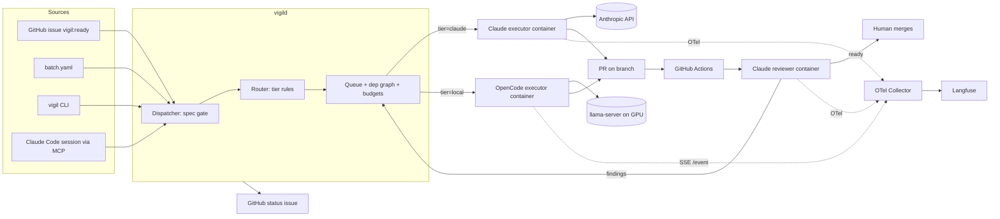

# Vigil: design doc

Oct 22, 2026 · @Thomas Bardhi

## Summary

Vigil is one orchestrator that runs many isolated coding sessions in parallel across your repos, routes each task to Claude or to a local model on your Linux tower, and records every session as one trace you can open. Claude does first drafts, anything hard or on a money/auth path, and every review. OpenCode workers on the tower do routine work for free.

The operating rule: **a task is a contract, not a chat.** Every session gets a written spec with a test that must go from red to green, runs in its own container and worktree, cannot merge or deploy, and ends in a PR that a fresh-context Claude reviews before a human merges. Spawn from the CLI (`vigil run`), from a Claude Code session (an MCP tool), or from a GitHub label; all three hit the same API.

Stack, pinned at build time: Python 3.12 orchestrator (FastAPI + SQLite/Postgres + a dependency-graph scheduler), OpenCode v2 server per worker container, llama.cpp `llama-server` on the tower, Claude Agent SDK for the Claude tier, OpenTelemetry into self-hosted Langfuse, Docker Compose, Tailscale.

## What an expert would insist on

These eight choices are where fleets fail or pay off. Each is a design constraint below, not advice.

1. **Local models fail on vague tasks, not on hard ones.** A 35B MoE can write a test from a spec; it cannot discover what the spec should be. So Claude writes specs, and the cheap tier only ever receives a task with a named test, named files and a definition of done. Routing is by *task shape*, not by how smart the model is.
2. **Isolation is physical, not configured.** OpenCode's permission JSON is friction, not a boundary; a model can `cat` what it was told not to `read`. The boundary is the container: read-only root, one worktree mounted, an egress allowlist, no secrets in the environment. Permissions only reduce wasted turns.
3. **The agent cannot grade itself.** Every PR gets a fresh-context Claude review that sees only the diff and the issue. Tests run in CI, not in the worker's shell, so a worker cannot weaken a test and call it green.
4. **One task contract for every executor.** Claude and OpenCode workers accept and return the same JSON. Swapping models or harnesses later costs nothing above a new executor plugin.
5. **Routing decisions are logged, and the eval tunes them.** Every `tier` choice carries a reason. Ten replayed issues per quarter decide which task shapes the tower keeps and which go back to Claude.
6. **Budgets are hard stops.** Daily Claude dollar cap and per-task token caps are enforced by the orchestrator, not by hope. Escalation from the tower to Claude happens after two failures, never silently.
7. **Traces are the product.** If you can't open a session and see every tool call, token and cost, you can't trust it unattended. Both tiers feed one trace store with one schema.
8. **Claude outputs never enter a training set.** A provenance tag on every artifact and a test that asserts the training pipeline rejects them.

## Architecture

Six components, all on your tower except the Claude API and GitHub. The Mac is optional: it can run the CLI and a Claude Code session that talks to the orchestrator over Tailscale.

| Component | Runs where | Job |
| --- | --- | --- |
| `vigild` (orchestrator) | tower, Docker | Task queue, dependency graph, routing, budgets, container lifecycle, status issue, REST + MCP API |
| `vigil` CLI + MCP server | Mac or tower | `vigil run`, `vigil ls`, `vigil trace`, `vigil kill`; the same calls exposed as MCP tools so a Claude Code session can dispatch |
| Claude executor | tower, one container per task | Claude Agent SDK, headless, API key, OTel on |
| OpenCode executor | tower, one container per task | `opencode serve` + worktree, pointed at `llama-server` |
| `llama-server` | tower host (GPU) | Qwen3.6-35B-A3B main, gpt-oss-20b for small jobs; 2 slots |
| Reviewer | tower, container per PR | Claude, fresh context, diff + issue + checklist only |
| Langfuse + OTel Collector | tower, Docker | One trace per session; dashboard |



The loop: a task enters, the spec gate rejects it unless it has a test and a done condition, the router assigns a tier with a reason, the queue starts a container when a slot and budget allow, the worker pushes a branch and opens a draft PR, CI runs, the reviewer posts findings or marks the PR ready, and findings re-enter the queue as a follow-up task (same tier, or escalated).

## Task contract

Every executor takes this in and hands this back. Nothing else crosses the boundary, so a new model or harness is one adapter.

```json
{
  "task_id": "pa-0142",
  "repo": "thomasbardhi01/parkagent",
  "base": "main",
  "branch": "vigil/pa-0142-rate-limit-tests",
  "tier": "local",
  "tier_reason": "label:tests + paths:tests/** + size:S",
  "spec": {
    "goal": "Add tests for rate limiting on /api/park",
    "test_cmd": "pytest tests/api/test_rate_limit.py -q",
    "must_fail_first": true,
    "files_in_scope": ["tests/api/test_rate_limit.py", "docs/feature-map.md"],
    "done_when": "test_cmd exits 0; docs/feature-map.md lists the limit",
    "out_of_scope": ["src/billing/**", "src/auth/**"]
  },
  "limits": { "max_turns": 60, "max_minutes": 40, "max_cost_usd": 4.00 },
  "depends_on": ["pa-0139"],
  "attempt": 1
}
```

Result:

```json
{
  "task_id": "pa-0142",
  "status": "pr_open | failed | escalate | timeout",
  "branch": "vigil/pa-0142-rate-limit-tests",
  "pr_url": "https://github.com/.../pull/312",
  "test_before": "fail", "test_after": "pass",
  "files_changed": ["tests/api/test_rate_limit.py", "docs/feature-map.md"],
  "summary": "3 tests; 429 after 10 req/min; docs updated",
  "usage": { "model": "qwen3.6-35b-a3b-q4", "tokens_in": 48210, "tokens_out": 6120, "cost_usd": 0, "gpu_seconds": 1130 },
  "trace_id": "lf-9c1d...",
  "provenance": "local"
}
```

The spec gate in `vigild` rejects a task without `test_cmd` and `done_when`. A GitHub issue without them is routed to Claude with the job "write the spec", which produces the contract above and re-queues the task; that is the cheapest Claude call in the system and the one that makes the tower useful.

## Intake: the fleet does not ship for the sake of shipping

A fleet that can produce PRs all night will fill your repos with PRs nobody wanted. The guard is at intake, not at review: no task runs until something has said why it is worth doing, and the fleet has a hard limit on open work.

1. **Every task carries a `why` and a `value` score (1–5) and a `risk` score (1–5).** Issues from you get these from the label set (`value:4`, `risk:2`). Issues the fleet generates (from an audit) must be scored by the decider model and are capped at `value ≥ 3` before they can enter the queue; the rest are filed as `vigil:proposed` for you to look at weekly.
2. **WIP limit per repo: 4 open fleet PRs.** When the limit is hit the queue stops, and the dashboard shows the stack waiting on you. Merging, not spawning, is the bottleneck by design.
3. **Audits produce findings, not tasks.** The nightly audit (lint, dead code, dependency age, docs drift, flaky tests, bug reports from the prod suite) writes one issue per finding, scored by the decider, and never dispatches work itself. Bugs with `risk ≥ 4` or a failing prod check page you instead of waiting for the weekly look.
4. **A weekly `vigil report`** lists what shipped, what was proposed and declined, cost, and escalation rate. If the escalation rate or declined-proposal rate climbs, the fleet is generating noise and the audit thresholds get tightened.
5. **Nothing self-generated touches a money, auth or consent path** without you creating the issue by hand.

The loop is: ship features you asked for → fix bugs the prod suite and audits find → audit → propose → you decide what enters next. The fleet repeats; you steer.

## Routing rules and escalation

Rules run top to bottom; the first match wins and its name is written to `tier_reason`. Size is estimated from the spec's `files_in_scope` and the issue body length.

| # | Condition | Tier | Model |
| --- | --- | --- | --- |
| 1 | Task has no `test_cmd` or `done_when` | claude | Sonnet (spec-writing only, no code) |
| 2 | Paths touch `src/billing/**`, `src/auth/**`, `**/payments/**`, `**/consent/**`, Stripe/Fly config | claude | Opus |
| 3 | Label `architecture`, `migration`, or touches `docs/architecture.md` structure | claude | Opus |
| 4 | New feature with no existing tests in scope | claude | Sonnet (first pass) |
| 5 | `attempt` ≥ 3, or two review rounds with findings | claude | Sonnet (escalated) |
| 6 | Label `tests`, `docs`, `deps`, `lint`, `copy`, `ui-small`; size S or M; ≥1 existing test in scope | local | Qwen3.6-35B-A3B |
| 7 | Size XS (one file, < 40 lines expected), docs or lint only | local-fast | gpt-oss-20b |
| 8 | Review follow-up on non-money code, size S | local | Qwen3.6-35B-A3B |
| 9 | Anything else | claude | Sonnet |

Reviews follow the trust ladder in the next section: Claude on everything at first, local reviewers graduating per task shape as their audits pass. Money-path PRs (rule 2) are always reviewed by Claude Opus and never graduate.

Escalation ladder for a `local` task: attempt 1 and 2 on the tower (second attempt gets the reviewer's findings appended to the spec); attempt 3 goes to Claude Sonnet with the prior diffs attached as context. A task that times out twice on the tower is re-sized to L and skips to Claude. All of this is written to the task record and to the status issue.

Two overrides you can set per task: `vigil run --tier claude` forces the tier, and a `vigil:local-ok` label on a money-path issue is refused (rule 2 is not overridable).

## Decider: typed decisions, not prose

The fleet makes hundreds of small closed decisions a day that are not coding: which tier, how big, how risky, is this proposal worth it, does this review need escalation, is this finding a duplicate. Those go to a **decider** with one interface: state in (issue text, spec, diff summary, or review JSON), typed questions out (a choice from a fixed set, a score, or a yes/no), each with a probability. `vigild` acts when confidence clears a threshold and escalates to Haiku, then to you, when it doesn't. The decider never writes code or prose.

This is what TypeSafe's Jev does natively: it returns typed choices and scores with calibrated probabilities in 70–500 ms, supports up to 255 options per choice, and costs $0.042 per million input tokens with output free ([TypeSafe](https://typesafe.ai/blog/introducing-system-one-models-and-jev), [Cloudflare model page](https://developers.cloudflare.com/ai/models/typesafe/jev/)). Direct access is waitlisted, but it is callable today through OpenRouter (`jev-latest`), Vercel AI Gateway and Cloudflare Workers AI, the last with zero data retention.

| Backend | Where | Use |
| --- | --- | --- |
| Jev via Cloudflare Workers AI or OpenRouter | hosted | default decider; zero-retention route for private repos, any route for public ones |
| Claude Haiku with constrained JSON output | hosted | ceiling in the eval, and the escalation target when Jev's confidence is low |
| Liquid AI LFM (1–3B instruct) with a JSON-schema grammar in llama.cpp, logprobs read for confidence | tower | local fallback when offline, and the eval candidate for "can a small open model match Jev on these questions" |

The decider questions are declared in code (`vigild/decider/questions.py`), one schema shared by all three backends, so swapping backends is config. Questions at launch: `tier` (choice), `size` (XS–L), `value` and `risk` (scores 1–5), `touches_money_path` (bool, used only as a second check behind the path rules, never instead of them), `worth_proposing` (bool), `needs_escalation` (bool, on a review's findings), `duplicate_of` (choice over open issue ids, capped at 255).

Thresholds start at 0.85 to act and 0.6 to escalate to Haiku; below 0.6 the task waits for you. The eval measures each backend's agreement with your own labels on 30 past issues, and the thresholds are tuned from that, not guessed.

One repo covers both public and private targets. `vigil` is a single private repo; the decider backend is chosen per target repo in `configs/repos.yaml`, and `vigild` refuses to send a private repo's text to a backend not listed for it:

```yaml
repos:
  thomasbardhi01/parkagent:
    visibility: public
    decider: [jev-openrouter, haiku, lfm-tower]
    worker_overflow: [runpod]          # hosted eval/overflow allowed
  thomasbardhi01/hearth:
    visibility: private
    decider: [lfm-tower, jev-cloudflare-zdr]   # drop the second entry to keep it fully local
    worker_overflow: []                # tower only
```

## Review tiers and the trust ladder

The end state is that Claude builds and runs end-to-end tests, and the fleet reviews itself. You get there by measuring, not by deciding. A local reviewer earns the right to be the only reviewer for a task shape; it never gets it by default.

| Rung | Who reviews | Who audits | Graduates when |
| --- | --- | --- | --- |
| 0 (build phase) | Claude Sonnet, fresh context | Claude Opus audits 100% of reviews: did the review catch what the audit catches? | n/a; this is where every shape starts |
| 1 | Local reviewer (Qwen3.8-27B or best eval model) **and** Claude Sonnet, both blind | Claude Opus compares the two reviews | local reviewer finds ≥ 90% of Claude's findings and raises ≤ 1 false finding per PR, over 20 PRs of that shape |
| 2 | Local reviewer only | Claude Sonnet audits a 25% sample | sample shows no missed finding of severity ≥ medium over 40 PRs |
| 3 | Local reviewer only | Claude audits a 10% sample, forever | a missed medium finding or any missed high finding drops the shape back to rung 1 |

Shapes graduate independently: docs and dependency bumps will reach rung 3 in weeks; tests-from-spec may take longer; money, auth and consent paths stay at rung 0 permanently. The ladder state lives in `configs/review.yaml` and `vigild` edits it from the audit data; you see every promotion and demotion in the weekly report.

The review contract is the same for every reviewer: input is the diff, the issue, the spec, and the checklist; output is `findings[] {severity, file, line, claim, fix}` plus a verdict. Claude-as-auditor scores a review by matching its findings against the auditor's own, and that match rate is the number the ladder runs on.

What Claude does once shapes graduate: first drafts of features, anything rung 0, end-to-end test authoring and the nightly suite against prod, and the audits above. That is the "rigorous stuff"; everything else is the fleet's.

## Tower: local model serving

Hardware: Linux, RTX 5070 Ti (16 GB GDDR7), 32 GB DDR5. The right shape is a mixture-of-experts model with experts offloaded to system RAM, served by llama.cpp, which has `--n-cpu-moe` and `--cpu-moe` for exactly this ([llama-server manual](https://manpages.debian.org/unstable/llama.cpp-tools/llama-server.1.en.html)). vLLM needs the whole model in VRAM, so it is not used here.

| Model | Fit | Role | Serve on |
| --- | --- | --- | --- |
| Qwen3.6-35B-A3B, Q4\_K\_M GGUF (\~20 GB) | attention + KV on GPU, experts in DDR5 | main `local` worker | port 8080, 2 slots × 64k ctx |
| gpt-oss-20b, MXFP4 GGUF (\~14 GB) | fully on GPU | `local-fast` for XS tasks | port 8081, 1 slot × 32k ctx, loaded only when 8080 is idle |
| Qwen3.8-27B, Q3 (\~12 GB) | on GPU, short ctx | eval candidate only | not resident |

Both cannot be resident at once in 16 GB. `vigild` owns model lifecycle: it keeps Qwen resident, and swaps in gpt-oss-20b only when the queue holds XS tasks and no `local` task is running. Swap cost is 10–20 s of load, cheaper than the quality loss of running XS tasks on nothing.

Starting command (tune `--n-cpu-moe` upward until `nvidia-smi` shows \~15 GB used; prefix caching stays on by default and is what makes agent turns fast):

```bash
llama-server -m /models/Qwen3.6-35B-A3B-Q4_K_M.gguf \
  --n-gpu-layers 999 --n-cpu-moe 28 \
  -c 131072 --parallel 2 --jinja \
  --host 100.x.y.z --port 8080 --api-key "$LLAMA_KEY" \
  --metrics --slots
```

`-c 131072 --parallel 2` gives two 64k slots. `--jinja` enables the tool-call template OpenCode needs. `--metrics` exposes a Prometheus endpoint; `vigild` scrapes it for GPU-seconds per task and queue depth. Bind to the Tailscale IP, not `0.0.0.0`.

Run it as a systemd unit on the host (not in Docker) so the CUDA Blackwell build and GPU are simple; worker containers reach it over the Tailscale address. Pin the llama.cpp release tag and the GGUF file hashes in `models.lock`.

Expect 1–2 concurrent sessions and measure tokens/s on your machine in the first week; the eval section uses those numbers. If the eval shows Qwen3.6-35B-A3B is not good enough for the `local` task shapes, RunPod H100 overflow runs the same OpenCode container against a vLLM endpoint, nothing else changes.

## OpenCode executor

One container per task runs `opencode serve` with the worktree as its only project; `vigild` drives it over HTTP and reads the event stream. OpenCode v2 shipped this month, and its config format changed, so the build pins v2 and uses the v2 permissions array ([v2 permissions](https://v2.opencode.ai/permissions), [server API](https://opencode.ai/docs/server/)).

Session flow, per task:

1. `vigild` creates the worktree on the host (`git worktree add`), writes the task contract to `.vigil/task.json` in it, and starts the container with the worktree mounted at `/work`.
2. Container starts `OPENCODE_SERVER_PASSWORD=… opencode serve --hostname 0.0.0.0 --port 4096` and `vigild` waits on `GET /global/health`.
3. `vigild` opens `GET /event` (SSE) and keeps it open for the life of the session; every bus event is forwarded to the OTel collector as a span or log under the task's trace id.
4. `POST /session` then `POST /session/:id/prompt_async` with the spec rendered as the prompt. The container's `AGENTS.md` is a symlink to the repo's `CLAUDE.md`, so both tiers read the same rules.
5. On `session.idle`, `vigild` calls `GET /session/:id/diff`, checks `files_changed` against `files_in_scope`, runs nothing itself, and tells the worker to commit and push (a `shell` allow rule) and open a draft PR with the worker token.
6. `POST /session/:id/abort` on timeout, turn cap, or `vigil kill`. The container is removed; the worktree stays until the PR closes.

`opencode.json` baked into the image (last matching rule wins, so denies go last):

```json
{
  "$schema": "https://opencode.ai/config.json",
  "provider": { "tower": { "npm": "@ai-sdk/openai-compatible",
    "options": { "baseURL": "http://100.x.y.z:8080/v1", "apiKey": "{env:LLAMA_KEY}" },
    "models": { "qwen3.6-35b-a3b": { "limit": { "context": 65536 } } } } },
  "model": "tower/qwen3.6-35b-a3b",
  "permissions": [
    { "action": "*", "resource": "*", "effect": "allow" },
    { "action": "external_directory", "resource": "*", "effect": "deny" },
    { "action": "edit", "resource": "/work/*", "effect": "allow" },
    { "action": "edit", "resource": "/work/.github/*", "effect": "deny" },
    { "action": "edit", "resource": "/work/.opencode/*", "effect": "deny" },
    { "action": "read", "resource": "*.env", "effect": "deny" },
    { "action": "read", "resource": "*.env.*", "effect": "deny" },
    { "action": "read", "resource": "*Config.xcconfig", "effect": "deny" },
    { "action": "shell", "resource": "git push*main*", "effect": "deny" },
    { "action": "shell", "resource": "gh pr merge*", "effect": "deny" },
    { "action": "shell", "resource": "gh pr review*--approve*", "effect": "deny" },
    { "action": "shell", "resource": "gh api*", "effect": "deny" },
    { "action": "shell", "resource": "gh secret*", "effect": "deny" },
    { "action": "shell", "resource": "fly *", "effect": "deny" },
    { "action": "shell", "resource": "curl*", "effect": "deny" },
    { "action": "shell", "resource": "*--no-verify*", "effect": "deny" },
    { "action": "webfetch", "resource": "*", "effect": "deny" },
    { "action": "websearch", "resource": "*", "effect": "deny" }
  ]
}
```

Run the server with `--auto` so only explicit denies block; without it a headless run rejects every `ask`. OpenCode's own docs say the shell resource is raw text and best-effort, so this list is the first layer only; the container (next section) is the real one.

Why OpenCode over OpenHands, in one paragraph: OpenHands bundles its own sandbox and a heavier runtime per session, which duplicates what Docker Compose already gives you, and its agent loop is harder to drive turn-by-turn from outside. OpenCode is a thin server with an OpenAPI spec, a per-session SSE bus, fork/abort/diff endpoints and a permission model that mirrors your guard plugin. For a fleet where the orchestrator owns isolation, the thin server wins. If a future model needs OpenHands-specific tooling, it is one more executor adapter.

## Claude tier and how you spawn sessions

**Claude executor.** A container running the Claude Agent SDK (Python) with `permission_mode="bypassPermissions"` inside the sandbox, the same guard hooks from ParkAgent mounted as `settings.json` deny rules, and OTel on. The SDK runs the Claude Code CLI as a child process and exports spans, metrics and log events over OTLP when `CLAUDE_CODE_ENABLE_TELEMETRY=1`, `CLAUDE_CODE_ENHANCED_TELEMETRY_BETA=1` and the three `OTEL_*_EXPORTER=otlp` variables are set ([Agent SDK observability](https://code.claude.com/docs/en/agent-sdk/observability)). `vigild` sets `OTEL_RESOURCE_ATTRIBUTES=vigil.task_id=…,vigil.tier=claude,vigil.repo=…` and `TRACEPARENT` so the run nests under the task's trace. It bills to an API key in its own Console workspace, so Claude spend shows up separately from your Max plan.

**Reviewer.** Same container image, different prompt: it gets the diff from `gh pr diff`, the issue text, and the checklist (wrong charge or consent bypass, test fails before fix, docs updated, no weakened tests, what could be deleted). It can read the repo but has `edit: deny`. It posts a PR review as comments and returns `findings[]` to `vigild`. Empty findings plus green CI marks the PR "ready for human merge"; anything else re-queues a follow-up task.

**Three ways to spawn, one API.** `vigild` exposes a REST API on the Tailscale interface and the same operations as an MCP server, so you can dispatch from wherever you are:

| From | How | Example |
| --- | --- | --- |
| Terminal | `vigil` CLI (Python, `pipx install`) | `vigil run parkagent#142 --tier auto`, `vigil batch parkagent-batch.yaml`, `vigil ls --live`, `vigil trace pa-0142`, `vigil kill pa-0142` |
| Claude Code session (your Mac) | `vigil` MCP server added to `.mcp.json`; tools `vigil_run`, `vigil_status`, `vigil_trace`, `vigil_kill` | "Dispatch the three test tasks from the batch file to the tower and tell me when PRs are open" |
| GitHub | label `vigil:ready` on an issue; `vigild` polls or receives a webhook | coord labels issues; the fleet picks them up |

The Claude Code route is how coord keeps its role: coord decides and dispatches, `vigild` executes and reports. Coord never runs workers itself anymore, which also frees your Max-plan session from doing the cheap work.

`vigil ls --live` streams a table: task, tier, model, status, turns, minutes, cost or GPU-seconds, PR, CI, review. `vigil trace <id>` prints the Langfuse URL and a 30-line summary of the tool calls.

## Security: three layers, no secrets in workers

No session can merge, push to main, deploy, or read a secret. Each of these is stopped in three independent places, so a bypass of one still fails.

| Threat | Layer 1: GitHub | Layer 2: container | Layer 3: harness config |
| --- | --- | --- | --- |
| Merge or approve | GitHub App installation token per task, scoped to the one repo, `contents:write`, `pull_requests:write`, no `administration`; ruleset on `main` requires PR + checks and blocks force push | token lives in a tmpfs file read by a `git credential` helper, not in env | `gh pr merge*`, `gh pr review*--approve*`, `gh api*` denied |
| Push to main | ruleset: direct pushes to `main` blocked | pre-push hook in the image refuses `main` | `git push*main*` denied |
| Deploy / prod | worker token has no Fly, no prod access | egress allowlist: `api.github.com`, `github.com`, `registry.npmjs.org`, `pypi.org`, tower `llama-server`, `api.anthropic.com` (Claude tier only); nothing else resolves | `fly *` denied |
| Read secrets | — | no `.env`, no `~/.aws`, no SSH keys mounted; root FS read-only; only `/work` and `/tmp` writable | `read *.env*` denied |
| Escape the worktree | — | only the worktree is mounted; user is non-root; `--cap-drop ALL`, `--pids-limit 512`, memory cap | `external_directory` denied |
| Change its own rules | — | `.opencode/`, `.github/`, `.claude/settings.json` mounted read-only over the worktree | `edit .github/*`, `edit .opencode/*` denied |

Egress is enforced with a per-container network namespace and an nftables allowlist on the tower, or a sidecar proxy that only forwards to the allowlist; pick the simpler one at build time. The `llama-server` port is reachable only from the Docker network and the Tailscale interface.

Tokens: a GitHub App installation token is minted by `vigild` per task with a 1-hour life and revoked when the container exits. The Anthropic key is in the Claude executor container only, and `vigild` reads cost from the SDK result stream so the key never has to be shared with the dashboard. Rotation is one command in the runbook.

Tests run in GitHub Actions on the PR branch, never trusted from the worker's shell. A worker that edits a test file in a non-`tests` task fails the spec gate on return.

Anything that needs a secret (migrations against prod, Fly secrets, Stripe keys) is a task type the router refuses; it opens an issue for you instead.

## Tracking: one trace per session

Every session, from either tier, becomes one trace in self-hosted Langfuse, with the task id as the trace name and `tier`, `model`, `repo`, `branch`, `pr_url`, `attempt` as tags. An OpenTelemetry Collector sits in front so both tiers write the same way.

| Source | How it reaches the collector | What you get |
| --- | --- | --- |
| Claude executor and reviewer | CLI's built-in OTLP export (traces + metrics + logs), `TRACEPARENT` from `vigild` | one span per turn, per model request (tokens, latency), per tool call, per hook; cost from the SDK result message |
| OpenCode executor | `vigild` subscribes to `/event` and translates bus events (`message.part.delta`, tool start/finish, `session.idle`, permission events) into OTLP spans with the same names | one span per turn and per tool call; tokens from the message usage fields; GPU-seconds from `llama-server` `/metrics` deltas |
| `vigild` itself | its own spans: `vigil.route`, `vigil.spawn`, `vigil.review`, `vigil.escalate` | the routing reason and every state change in the same trace |

Why Langfuse over Phoenix: Langfuse is MIT, runs identically self-hosted and on ClickHouse, which handles long agent traces with large payloads well, and it is a named target in Anthropic's own Agent SDK docs ([comparison](https://langfuse.com/compare/arize-phoenix)). Phoenix is lighter to run (one container) but its Elastic licence and the Dynatrace acquisition of Arize make it a weaker long-term bet. Self-hosted Langfuse is five containers; the Compose file includes them.

Tool content is off by default; the Claude tier turns on `OTEL_LOG_TOOL_DETAILS=1` so commands and file paths show, and `OTEL_LOG_TOOL_CONTENT=1` only for the reviewer, whose inputs are a diff you already own. Prompts are logged for both tiers because you own the repos.

**Dashboard.** Langfuse's sessions view is the drill-down. A 200-line page in `vigild` (`/`) is the fleet view: live table of sessions, budget gauges (Claude $ today, GPU hours today), queue depth, and a per-repo pass-rate sparkline over the last 30 tasks. Each row links to its Langfuse trace, PR and status issue. Expose it on Tailscale only.

**Cost accounting.** Claude cost is read from the SDK's final result message per session and summed in `vigild`'s SQLite; GPU time is `llama-server` slot-busy seconds attributed to the session that held the slot. Electricity is estimated at 0.4 kW × GPU-hours × your rate, shown next to the Claude number so the comparison is honest.

## Cost model and GPU lifecycle

The tower has no hourly cost, so the question is only whether the local tier's failures cost more in Claude re-runs and reviews than they save. The eval answers that; the model below is what the eval is checked against. Per-task Claude figures are placeholders to replace with your first week's data (figures marked approximate).

| Line | All-Claude | 30% Claude / 70% local |
| --- | --- | --- |
| Tasks per day | 10 | 3 Claude + 7 local |
| Claude worker cost (approx. $3 S/M task, $9 L task) | \~$45 | \~$20 (Claude tasks are the large ones) |
| Claude reviews (approx. $0.80 each, 1.3 rounds avg) | \~$10 | \~$10 |
| Spec-writing calls for local tasks (approx. $0.30) | — | \~$2 |
| Escalations (20% of local tasks go to Claude on attempt 3, approx. $3) | — | \~$4 |
| Electricity (0.4 kW, \~5 GPU-hours, $0.25/kWh) | — | \~$0.50 |
| Total per day | \~$55 | \~$37 |

At a 20% escalation rate the local tier saves about a third. At 50% escalation it saves nothing, and the right move is to narrow rules 6–8 to the task shapes it passes. `vigild` computes this table from real data every day and shows it on the dashboard, so the decision is never a guess.

**GPU lifecycle on the tower.** `llama-server` stays resident while the queue has local work and unloads after 30 idle minutes (a systemd timer calls `vigild` which stops the unit), dropping idle power to a few watts. Load time is 15–30 s from NVMe, so the first task of a batch pays that once. gpt-oss-20b swaps in only for XS tasks, as described above.

**Overflow.** RunPod serverless (scale-to-zero) running vLLM with a bigger model is the only paid GPU option in the design, and it is off until the eval shows a task shape where the tower's models fail and the hosted model passes. A persistent rented H100 at \~$2–3/hour costs more per day than the all-Claude column; it is never worth it for one developer.

## Eval protocol

The eval is a replay of closed ParkAgent issues with the merged PR hidden, scored by the same CI and the same reviewer. It runs before the routing rules go live and again whenever a model or rule changes.

1. Pick 10 closed issues: 4 tests-from-spec, 2 docs, 2 dependency bumps, 2 small UI/copy. Write the spec for each the way the spec gate requires (Claude does this once; the specs are reused for every candidate).
2. Run all 10 as `local` tasks from the same base commit, for each candidate. Workers: Qwen3.8-27B Q3 (dense, on GPU, short context), Qwen3.6-35B-A3B Q4 (MoE, experts in RAM), gpt-oss-20b (on GPU); DeepSeek V4.1 Flash via a hosted API (eval only, ParkAgent is public). Ceilings: Claude Sonnet and Claude Haiku, so you see where each local model lands between them. Reviewers: the same list, scored against Claude Opus as the auditor.
3. Decider: Jev (via Cloudflare or OpenRouter), Haiku with constrained JSON, and a Liquid AI LFM 1–3B on the tower, each answering the launch question set over the 10 specs plus 20 past issues, judged against your own labels. Score agreement, calibration (does 0.85 confidence mean 85% right), latency and cost per decision.
4. Score each run: CI pass on first PR, reviewer findings count, turns, wall time, cost (Claude) or GPU-seconds (tower), and "would a human merge this unchanged" (you, 2 minutes each). For reviewers: findings matched against the auditor, false findings per PR.
5. Decide per task shape, not per model: a shape stays `local` only if the chosen model passes CI first try on ≥ 70% and averages ≤ 1 finding; a reviewer enters rung 1 only if it matches ≥ 80% of the auditor's findings on the eval set; a decider backend is the default only if its agreement with your labels is ≥ 90% at the act threshold.
6. Store the matrix in `evals/2026-10/results.csv` and link it from the routing section of the repo's docs. Re-run quarterly or on any model swap.

The eval also decides the GPU question: if DeepSeek V4.1 Flash passes shapes the tower fails, a RunPod serverless adapter is worth building; if not, it isn't.

**Training-data firewall (optional later phase).** Fine-tuning the local model is allowed only on its own attempts graded by your test suite. Every artifact `vigild` stores carries `provenance: claude | local | human`, the training exporter filters on `provenance == local`, and a unit test asserts that a fixture tagged `claude` is rejected. Merged PRs written by Claude are never exported. This keeps you inside Anthropic's terms without relying on memory.

## Repo layout and build order

A separate repo, `vigil`, with the same rules as ParkAgent (tests first, docs in the same PR, one way per thing, pinned versions ≥ 2 weeks old).

```text
vigil/
  vigild/            FastAPI app: api/, router/, scheduler/, executors/{claude,opencode}/, review/, telemetry/, web/
  cli/               `vigil` CLI and the MCP server (same client library)
  images/            Dockerfiles: claude-executor, opencode-executor, reviewer
  tower/             systemd units for llama-server, models.lock, nftables egress rules, swap script
  compose.yaml       vigild, otel-collector, langfuse (5 services), postgres
  configs/           opencode.json, claude settings.json, routing.yaml, budgets.yaml, repos.yaml
  evals/             specs/, run.py, results/
  docs/              architecture.md, feature-map.md, runbook.md, routing.md
  tests/
```

Build order: everything is built and proven with Claude models first, through the Claude executor, so the fleet works end to end before any local model is involved. The tower is the last thing plugged in. This is possible because the only model-specific code is an executor adapter and a provider block; `vigild`, the contract, routing, review ladder, budgets and tracing never know which model is behind a tier. Build sessions use Opus for architecture and the first pass of each phase, Sonnet for the rest.

| Phase | Delivers | Done when |
| --- | --- | --- |
| 1. Core, all Claude | `vigild`, task contract, spec gate, intake scoring through the decider interface (Jev via Cloudflare, Haiku fallback), Claude executor image, worktree + container spawn, GitHub App tokens, OTel → Langfuse | one ParkAgent docs task runs Sonnet in a container, opens a draft PR, trace visible |
| 2. Review ladder + fleet | reviewer (Sonnet) + auditor (Opus), rung-0 audit of 100%, scheduler with dep graph, 3 parallel containers, budgets, WIP limit, escalation, `vigil` CLI + MCP server, dashboard | 3 batch tasks run in parallel, reviewed and audited; `vigil kill` works; dispatched once from a Claude Code session |
| 3. Second executor, still Claude | OpenCode executor image pointed at Claude through OpenCode's Anthropic provider; both executors pass the same contract tests | the same docs task passes through both executors with identical results and traces |
| 4. Tower | llama-server unit, models.lock, egress rules, swap script, OpenCode provider switched to the tower, LFM added as the local decider backend | `tower/check.sh` passes; one local task opens a PR; tokens/s recorded |
| 5. Eval + tuning | `evals/run.py` over workers, reviewers and deciders; routing.yaml and review.yaml edited from results | results.csv committed; first shapes at rung 1; cost table on dashboard uses real numbers |

After phase 4: the training-data firewall, RunPod overflow adapter if the eval calls for it, and a second repo added via `repos.yaml`.

## What you set up by hand, and open questions

By hand, once:

- [ ] Tower: NVIDIA driver + CUDA for Blackwell, Docker with the NVIDIA runtime, Tailscale joined, NVMe space for \~40 GB of GGUFs
- [ ] GitHub App "vigil-worker" installed on each repo with `contents:write` and `pull_requests:write` only; private key stored on the tower outside any worker mount
- [ ] Branch ruleset on `main` in every repo (PR required, checks required, no force push); the fleet never gets admin
- [ ] Anthropic Console workspace "vigil" with its own API key and a monthly spend limit
- [ ] Langfuse admin login and the OTel collector token
- [ ] `AGENTS.md → CLAUDE.md` symlink committed in each repo; `docs/feature-map.md` and `docs/architecture.md` kept current, since they are the local model's whole map of the codebase

Open questions for the build session (answer before phase 1):

1. Daily Claude cap and per-task cost cap: the doc assumes $40/day and $4 per local-escalated task.
2. Which repos after ParkAgent, and whether any are private (private repos never go to a hosted eval API).
3. Does Hearth also use the 5070 Ti? If so, `vigild` needs a schedule or a VRAM reservation, and 2 slots may become 1.
4. Mac or tower for the `vigil` CLI day to day? The design works from either over Tailscale; the MCP server runs wherever Claude Code runs.

## Build prompt

Paste this into a fresh Claude Code session in an empty `vigil` repo, with this doc exported as `docs/design.md` beside it.

**Vigil coord.** Run the build as its own coordinator session in the `vigil` repo, separate from ParkAgent's coord. It dispatches one worker per phase, reviews each PR with a fresh adversarial subagent, keeps a status issue, and never touches ParkAgent. Kickoff, pasted first in a new Claude Code session with Opus:

```markdown
You are vigil-coord, the coordinator for the vigil repo. Work the same way ParkAgent's coord does: you plan and dispatch, workers build in their own git worktrees and branches, you review every PR with a fresh-context adversarial subagent, I merge. Keep a GitHub status issue titled "vigil-coord status" updated after every step. Never run work in the ParkAgent repo; it has its own coord.

The spec is docs/design.md. Read it fully. Then run the build prompt at the end of it exactly as written: ask me its four questions, write docs/architecture.md and docs/feature-map.md as PR 1, and wait for my OK before dispatching phase 1.

Dispatch one worker per phase, in order, and do not dispatch phase N+1 until I merge phase N. Give each worker the phase row from the design doc, the hard constraints, and the "done when" check, and require the check's output in the PR description. Use Opus for the phase-1 and phase-2 workers and for every review; Sonnet for later phases unless a review sends work back twice.

When phase 2 merges, tell me how to point ParkAgent's coord at vigild (the MCP server config to add to its .mcp.json). Until then ParkAgent keeps running workers as it does today.
```

```markdown
Build vigil from docs/design.md. Read it fully first; it is the spec. Do not re-decide what it decides. Where it says "pick at build time", pick, state why in docs/architecture.md, and move on.

Rules (same as ParkAgent): tests fail before the fix; docs/architecture.md and docs/feature-map.md update in the same PR; no new dependency without a one-line reason in the PR; one way to do each thing; every version pinned to a release at least two weeks old. Search the web for the current docs of the Claude Agent SDK (Python, OTel env vars, permission modes, hooks), OpenCode v2 (server API, v2 permissions array, provider config, Anthropic provider), llama.cpp llama-server flags (--n-cpu-moe, --parallel, --jinja, --metrics), Langfuse self-hosting, TypeSafe Jev (API, Cloudflare and OpenRouter routes, question types), Liquid AI LFM serving in llama.cpp with JSON-schema grammars, and GitHub App installation tokens. Cite what you used in docs/sources.md.

Build order is Claude-first and model-agnostic: phases 1–3 use only Claude models (Opus for architecture and first passes, Sonnet otherwise, Jev through Cloudflare Workers AI or OpenRouter as the decider, Haiku with constrained JSON as its fallback, behind one typed-question interface) and must work end to end before phase 4 touches the tower. vigild, the task contract, routing, the review ladder, budgets and tracing must not know which model is behind a tier; only executor adapters and provider config do. One PR per phase, in order. Each PR ends with the phase's "done when" check actually run and its output pasted into the PR description. Do not start phase N+1 until I merge phase N.

Hard constraints, enforce in code and test them:
- No worker can merge, push to main, deploy, read .env*, or escape its worktree. Three layers as in the design doc. Write a test per threat row that spawns a worker container and asserts the action fails.
- No Claude-generated text can enter a training export: provenance tags on every stored artifact plus a test that a `claude`-tagged fixture is rejected by the exporter.
- Budgets and the per-repo WIP limit are hard stops in vigild; tests prove the daily cap and the WIP limit halt dispatch.
- Intake: no task runs without why/value/risk; self-generated tasks need value ≥ 3 and never touch money/auth/consent paths. Test both.
- Review ladder: rung state is data in configs/review.yaml, promotions and demotions are computed from audit match rates, and money-path shapes cannot be promoted. Test the demotion path.
- The task contract JSON is the only interface between vigild and executors; both executors pass the same contract test suite.

Before writing code, ask me these and nothing else: (1) daily Claude cap and per-task cap, (2) repos after parkagent and which are private, (3) whether Hearth shares the GPU, (4) Mac or tower for the CLI. Then write docs/architecture.md and docs/feature-map.md as the first PR with the plan for all phases, and wait for my OK.
```

Sources used for this design: [OpenCode server API](https://opencode.ai/docs/server/) · [OpenCode v2 permissions](https://v2.opencode.ai/permissions) · [Claude Agent SDK observability](https://code.claude.com/docs/en/agent-sdk/observability) · [llama-server manual](https://manpages.debian.org/unstable/llama.cpp-tools/llama-server.1.en.html) · [Langfuse vs Phoenix](https://langfuse.com/compare/arize-phoenix) · earlier chat: Anthropic training-use policy, Muse Glimmer, Qwen3.6/3.8 benchmarks.
